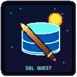

# System State and Architecture Blueprint

> Handoff snapshot generated 2026-11-03 for migrating SQL Quest to a new machine. The complete active application source is included below; its CSS and JavaScript are inline in `index.html`, with no separate `.css` or `.js` files.

## 1. Current architecture

- **Runtime:** dependency-free browser game opened directly from `index.html`; no package manifest, bundler, server, or external runtime dependencies.
- **Application entry point:** `index.html` contains the full HTML, a large inline `<style>` block, and an inline `<script>` block. It is the authoritative source for UI, curriculum/questions, combat logic, rendering, local storage, and interaction handlers.
- **Presentation:** CSS custom properties, themed biome backgrounds, responsive character picker and arena, CSS sprite slicing, attack/VFX animations, defeat fades, and reduced-motion behavior.
- **Game state:** inline JavaScript manages chapters, SQL lessons/quizzes and written boss answers; character selection, XP, attacks, combat health, progression, localStorage persistence, and DOM rendering.
- **Character model rendering:** CSS background-position slicing from six-frame horizontal sheets. The saved class id maps to a frame. Combat prefers the full-body sheet and falls back to the existing inline SVG art if the model image is unavailable.
- **Map/progression:** horizontal chapter route strip with unlocked/current/completed states and boss markers; this is not a tile/grid map.
- **Tests/build:** no test suite, build script, or package manager is present. Validation used inline JavaScript syntax checks, `git diff --check`, and browser checks.
- **Source sections:** markup near the start of `index.html`; all CSS in `<style>`; class/asset registry in the inline script; `renderCharacterSelect`, `validatePortraitSheet`, `validateFullModelSheet`, `renderHeroPortrait`, `renderBattlefield`, and `render` implement relevant asset/state/UI behavior.

## 2. Workspace file tree

```text
octo-enigma/
├── .git/                              # Repository metadata; contents omitted
├── README.md                          # Play guide, curriculum, asset notes
├── SYSTEM_STATE_AND_ARCHITECTURE_BLUEPRINT.md # This complete migration handoff
├── game-icon.svg                      # Game logo/favicon
├── index.html                         # Complete app: HTML + inline CSS + inline JS
└── assets/
    ├── character_portraits.png        # Normalized 6-frame selection sheet, 1920×450
    ├── character_portraits.png.jpg    # Original uploaded selection reference, 1380×752
    ├── in_game_full_models.png        # Normalized 6-frame combat sheet, 1920×450
    └── in_game_full_models.png.jpg    # Original uploaded model-sheet reference, 1380×752
```

The `.png.jpg` files are original uploads whose actual file format is JPEG. The `.png` normalized sheets are generated derivatives used by the app. No `ability_icons.png` (or equivalent ability icon sheet) exists in the current `assets/` directory.

## 3. Asset registration registry

| Asset | Exists / wired | Dimensions | Frame mapping (left to right) | Usage |
|---|---|---:|---|---|
| `assets/character_portraits.png` | Yes; wired in character picker | 1920×450; six 320×450 frames | 0 DB Brute; 1 Query Ranger; 2 Server Crusher; 3 SQL Mage; 4 Schema Lich; 5 Index Thief | `.class-portrait`; `background-size: 600% 100%`; frame offsets 0%, 20%, 40%, 60%, 80%, 100%. |
| `assets/in_game_full_models.png` | Yes; wired for combat | 1920×450; six 320×450 frames | 0 DB Brute; 1 Query Ranger; 2 Server Crusher; 3 SQL Mage; 4 Schema Lich; 5 Index Thief | `.hero-model`; inline `fullModelFrames` registry; `background-size: 600% 100%`; same offsets. Selected saved class controls displayed frame. Sheet is dimension-validated; inline SVG is the fallback. |
| `assets/ability_icons.png` | **Not present / not wired** | Unknown | Not registered; do not assume one exists | Attack arsenal currently uses text/Unicode symbols and CSS VFX, not an ability sprite sheet. |

Note: the full-body upload’s source reference has five characters across the top and the Index Thief in a lower panel; the normalized sheet isolates the six figures into the listed six horizontal cells.

## 4. Current feature state and pending design work

- **Already implemented:** interactive topic lessons; four-option quizzes; written SQL boss questions; turn-based question/combat loop; three-heart health, retries and game-over state; attack selection/unlocks, projectiles, impact effects, shake, reduced-motion handling; character picker; six class sprites for picker and combat; XP/progression persistence; biome backgrounds; horizontal chapter route; responsive layout.
- **Terminal console:** not implemented as an interactive SQL terminal. Existing optional practice checks query keywords and boss prompts compare normalized SQL text; neither executes SQL against a database.
- **Combat screens:** the turn-based combat arena is already implemented. Future work would be polish/expansion, not creating the basic combat loop from scratch.
- **Map grid rendering loop:** not implemented. Current map is a horizontal chapter route strip; a node/tile grid is a possible future feature if desired.
- **Ability icon sheet:** pending only if supplied/created. There is no verified `ability_icons.png` in the workspace; current attack iconography is text/CSS.
- **Animation states from model sheets:** current full-body sheet has one static pose per class; per-class walk/attack/damage/death frames and animation loops need separate sprite frames/assets before they can be wired.
- **Asset follow-up:** preserve the original uploaded JPEGs; if replacing normalized sheets, keep the 6 × 320 × 450 horizontal contract or update the validators, CSS sizing, offsets, and frame map together.

## 5. Complete active source: `index.html`

The complete active HTML file follows. It includes the full stylesheet and JavaScript; there are no separate main JS or CSS files to append.

````html
<!-- BEGIN FULL INDEX.HTML -->
<!doctype html>
<html lang="en">
<head>
  <meta charset="utf-8">
  <meta name="viewport" content="width=device-width, initial-scale=1">
  <meta name="theme-color" content="#070a0a">
  <meta name="description" content="Learn practical SQL topic by topic in a retro turn-based browser adventure.">
  <link rel="icon" type="image/svg+xml" href="game-icon.svg">
  <link rel="apple-touch-icon" href="game-icon.svg">
  <title>SQL Quest — The Data Dungeon</title>
  <style>
    :root {
      color-scheme: dark;
      --bg: #070909;
      --panel: #0c0f0f;
      --panel-raised: #101413;
      --ink: #f5f4ec;
      --muted: #a4aaa2;
      --green: #84d69a;
      --green-deep: #234b34;
      --gold: #f0cb70;
      --red: #ff6b66;
      --line: #495b4e;
      --pixel: "Courier New", "Lucida Console", monospace;
      --body: "Segoe UI", "Arial", sans-serif;
      font-synthesis: none;
    }

    * { box-sizing: border-box; }
    html { background: var(--bg); scroll-behavior: smooth; }
    body { min-width: 320px; margin: 0; background-color: #08090b; background-image: radial-gradient(ellipse at 50% 0%, var(--world-haze, #142018) 0%, transparent 48%), repeating-linear-gradient(0deg, transparent 0 42px, #d6c6a009 43px 45px), repeating-linear-gradient(90deg, transparent 0 76px, #d6c6a008 77px 79px), linear-gradient(180deg, #0b0c10, #10100f 70%, #090a0b); color: var(--ink); font-family: var(--body); transition: background-color .5s ease; }
    body[data-biome="grove"] { --world-haze: #18362499; --world-accent: #9bd58c; --world-mortar: #84977320; }
    body[data-biome="cavern"] { --world-haze: #15344999; --world-accent: #85d9e3; --world-mortar: #81a5c023; }
    body[data-biome="forge"] { --world-haze: #45251499; --world-accent: #ffc16f; --world-mortar: #d3a27324; }
    body[data-biome="crypt"] { --world-haze: #321b5099; --world-accent: #d6a0fa; --world-mortar: #bca0d526; }
    body[data-biome="overlord"] { --world-haze: #51151d99; --world-accent: #ff8a75; --world-mortar: #df9b8a26; }
    button, textarea { font: inherit; }
    button { color: inherit; }
    button:focus-visible, textarea:focus-visible { outline: 2px solid var(--gold); outline-offset: 3px; }
    .shell { width: min(100% - 32px, 1060px); margin: 0 auto; padding: 18px 0 42px; }
    .shell.screen-shake { animation: screen-shake .36s steps(2, end); }
    .shell.shake-from-player { --shake-1: -4px; --shake-2: 4px; --shake-3: -3px; --shake-4: 2px; }
    .shell.shake-from-enemy { --shake-1: 4px; --shake-2: -4px; --shake-3: 3px; --shake-4: -2px; }
    body[data-screen="character-select"] #adventure-view { display: none; }
    .character-select { display: none; min-height: calc(100vh - 60px); padding: 28px 0 42px; }
    body[data-screen="character-select"] .character-select { display: block; }
    .class-heading { margin: 0 0 7px; color: #b7eef2; font: 800 clamp(22px, 4vw, 34px) var(--pixel); text-align: center; text-shadow: 0 0 16px #47c9ef55; }
    .class-intro { margin: 0 0 22px; color: #b6c4ca; font-size: 13px; line-height: 1.7; text-align: center; }
    .class-grid { display: grid; grid-template-columns: repeat(3, minmax(0, 1fr)); gap: 13px; }
    .class-card { position: relative; display: grid; grid-template-columns: 92px 1fr; min-height: 150px; align-items: center; gap: 12px; padding: 12px; overflow: hidden; border: 2px solid #33586a; background: linear-gradient(140deg, #0d1b25, #10121a 70%); color: var(--ink); text-align: left; cursor: pointer; transition: transform .16s ease, border-color .16s ease, box-shadow .16s ease; }
    .class-card::before { position: absolute; inset: 5px; border: 1px solid #41a7b72b; content: ""; pointer-events: none; }
    .class-card:hover, .class-card:focus-visible { transform: translateY(-2px); border-color: var(--class-color); }
    .class-card.selected { border-color: var(--class-color); box-shadow: inset 0 0 0 2px #14242c, 0 0 18px color-mix(in srgb, var(--class-color) 25%, transparent); }
    .class-portrait { position: relative; isolation: isolate; display: grid; width: 88px; height: 124px; place-items: center; overflow: hidden; border: 1px solid color-mix(in srgb, var(--class-color) 70%, #23313b); background: radial-gradient(ellipse, color-mix(in srgb, var(--class-color) 22%, #111722), #0c111a 75%); color: var(--class-color); font-size: 42px; transition: filter .16s ease, box-shadow .16s ease; }
    .class-portrait::before { position: absolute; inset: 0; z-index: 1; content: ""; }
    .class-portrait::after { position: absolute; inset: 0; z-index: 2; background: repeating-linear-gradient(180deg, #8ffcff0a 0 1px, transparent 1px 4px); box-shadow: inset 0 0 14px color-mix(in srgb, var(--class-color) 20%, transparent); content: ""; pointer-events: none; }
    body[data-portrait-sheet="ready"] .class-portrait[data-frame]::before { background-image: url("assets/character_portraits.png"); background-repeat: no-repeat; background-size: 600% 100%; image-rendering: pixelated; }
    .class-portrait[data-frame="0"]::before { background-position: 0% center; }
    .class-portrait[data-frame="1"]::before { background-position: 20% center; }
    .class-portrait[data-frame="2"]::before { background-position: 40% center; }
    .class-portrait[data-frame="3"]::before { background-position: 60% center; }
    .class-portrait[data-frame="4"]::before { background-position: 80% center; }
    .class-portrait[data-frame="5"]::before { background-position: 100% center; }
    .class-card:hover .class-portrait, .class-card:focus-visible .class-portrait { filter: drop-shadow(0 0 9px color-mix(in srgb, var(--class-color) 65%, transparent)); box-shadow: 0 0 13px color-mix(in srgb, var(--class-color) 35%, transparent); }
    .class-copy { position: relative; display: grid; gap: 7px; }
    .class-name { color: var(--class-color); font: 800 12px var(--pixel); letter-spacing: .3px; }
    .class-description { color: #bdc9ce; font-size: 11px; line-height: 1.55; }
    .class-style { color: #758992; font: 700 8px var(--pixel); letter-spacing: .4px; }
    .class-selected-mark { position: absolute; top: 8px; right: 9px; color: var(--class-color); font: 700 8px var(--pixel); }
    .class-actions { display: flex; justify-content: center; gap: 9px; margin-top: 20px; }
    .portrait-sheet-status { margin: 12px 0 0; color: #ffcf83; font: 700 10px/1.6 var(--pixel); text-align: center; }
    @keyframes screen-shake {
      0%, 100% { transform: translateX(0); }
      20% { transform: translateX(var(--shake-1)); }
      40% { transform: translateX(var(--shake-2)); }
      60% { transform: translateX(var(--shake-3)); }
      80% { transform: translateX(var(--shake-4)); }
    }
    .topbar { display: flex; align-items: center; justify-content: space-between; gap: 14px; padding: 0 3px 15px; border-bottom: 1px solid #29352d; }
    .brand { display: flex; align-items: center; gap: 11px; }
    .brand-mark { display: block; width: 43px; height: 43px; border: 1px solid #53677d; object-fit: cover; image-rendering: pixelated; }
    .brand-name { font: 800 16px var(--pixel); letter-spacing: 1px; }
    .brand-name span { display: block; margin-top: 4px; color: var(--muted); font: 700 9px var(--pixel); letter-spacing: 2px; }
    .top-controls { display: flex; align-items: center; gap: 12px; }
    .hud { display: flex; flex-wrap: wrap; align-items: center; justify-content: flex-end; gap: 8px; }
    .hud-chip { padding: 7px 10px; border: 1px solid #34463a; color: var(--muted); font: 700 11px var(--pixel); white-space: nowrap; }
    .hud-chip strong { color: var(--ink); }
    .reset-button { padding: 7px 9px; border: 1px solid transparent; background: transparent; color: var(--muted); font: 700 10px var(--pixel); cursor: pointer; }
    .reset-button:hover { border-color: var(--line); color: var(--ink); }
    .page-title { margin: 20px 2px 6px; font: 800 clamp(18px, 3vw, 23px) var(--pixel); letter-spacing: 1px; }
    .page-caption { margin: 0 2px 17px; color: var(--muted); font-size: 13px; line-height: 1.6; }
    .frame { border: 2px solid var(--ink); background: #070808ed; box-shadow: 0 0 0 1px #343b35, 7px 7px 0 #111715; }
    .route-panel { margin-bottom: 17px; padding: 13px 15px 14px; border-color: var(--line); box-shadow: inset 0 0 32px var(--world-haze, transparent), 0 0 0 1px #343b35, 7px 7px 0 #111715; transition: box-shadow .45s ease, border-color .45s ease; }
    .route-head { display: flex; align-items: center; justify-content: space-between; gap: 10px; margin-bottom: 11px; }
    .route-head h2, .section-title { margin: 0; color: var(--green); font: 700 11px var(--pixel); letter-spacing: .7px; }
    .route-count { color: var(--muted); font: 700 10px var(--pixel); }
    .route-track { display: flex; gap: 6px; overflow-x: auto; padding: 3px 2px 9px; scrollbar-color: #506253 #101311; scrollbar-width: thin; }
    .route-stop { flex: 0 0 37px; width: 37px; height: 35px; border: 1px solid #434c43; background: #111412; color: #777e74; font: 700 10px var(--pixel); cursor: not-allowed; }
    .route-stop.unlocked { border-color: #526b55; color: #d7e8d5; cursor: pointer; }
    .route-stop.current { border: 2px solid var(--gold); color: var(--gold); background: #292310; }
    .route-stop.complete { border-color: var(--green); color: var(--green); background: #142319; }
    .route-stop:hover:not(:disabled) { transform: translateY(-2px); }
    .route-stop.boss { flex-basis: 45px; width: 45px; height: 43px; border: 2px solid #a93c43; background: linear-gradient(145deg, #281011, #130b0c); color: #ffb1a4; box-shadow: inset 0 0 0 2px #3a1518, 0 0 8px #c9343433; }
    .route-stop.boss.unlocked { border-color: #e25b5f; color: #ffe4c5; }
    .route-stop.boss.complete { border-color: #db5b55; background: linear-gradient(145deg, #301819, #132017); color: #a9e3ad; }
    .route-stop.boss.current { border-color: #ff7774; background: #310f12; color: #fff0cf; box-shadow: inset 0 0 0 2px #591e22, 0 0 11px #e9484855; }
    .boss-marker { display: block; color: #ff726d; font-size: 15px; line-height: 14px; }
    .route-stop.boss.complete .boss-marker { color: #f1957e; }
    .boss-number { display: block; font-size: 8px; line-height: 10px; }
    .region-list { display: flex; flex-wrap: wrap; gap: 6px 12px; color: #969d94; font: 9px var(--pixel); }
    .region-list span { white-space: nowrap; }
    .region-list b { color: #d3ddce; font-weight: 700; }
    .encounter { overflow: hidden; }
    .encounter-head { display: flex; align-items: center; justify-content: space-between; gap: 12px; padding: 12px 15px; border-bottom: 1px solid #39443b; background: #101412; }
    .chapter-meta { color: var(--muted); font: 700 10px var(--pixel); letter-spacing: .4px; }
    .chapter-meta strong { color: var(--green); }
    .phase-chip { padding: 5px 8px; border: 1px solid #455648; color: var(--gold); font: 700 9px var(--pixel); white-space: nowrap; }
    .battlefield { position: relative; display: grid; grid-template-columns: minmax(0, 1fr) minmax(130px, 200px) minmax(0, 1fr); align-items: center; gap: 18px; min-height: 372px; padding: 30px 34px 40px; overflow: hidden; border-bottom: 1px solid var(--world-accent, #526753); background-color: #080b0c; background-image: linear-gradient(180deg, #111a24 0 55%, #503b2d 55.5% 57%, #392c24 58% 100%), linear-gradient(180deg, transparent 0 57%, #e8ad6729 57.2%, transparent 58%), repeating-linear-gradient(0deg, transparent 0 31px, var(--world-mortar, #84977320) 32px 34px), repeating-linear-gradient(90deg, transparent 0 70px, var(--world-mortar, #84977320) 71px 73px); transition: border-color .45s ease, background-color .45s ease; }
    .battlefield::before { position: absolute; inset: 0; z-index: 0; background-image: radial-gradient(ellipse at 50% 78%, var(--world-haze, transparent) 0%, transparent 48%), radial-gradient(ellipse at 50% 10%, #ffffff12 0%, transparent 60%), radial-gradient(ellipse at 12% 54%, #ffae4850 0%, transparent 16%), radial-gradient(ellipse at 88% 54%, #ffae4850 0%, transparent 16%), radial-gradient(ellipse 7px 15px at 12% 48%, #fff0ae 0%, #ff9a42 42%, transparent 100%), radial-gradient(ellipse 7px 15px at 88% 48%, #fff0ae 0%, #ff9a42 42%, transparent 100%), linear-gradient(90deg, transparent 0 6%, #0a111ae8 6.5% 8%, transparent 8.5% 91.5%, #0a111ae8 92% 93.5%, transparent 94%); content: ""; pointer-events: none; }
    .battlefield::after { position: absolute; inset: 9px; border: 1px solid #273c2c; content: ""; pointer-events: none; }
    .battlefield.boss-arena { border-color: #d75c5a; background-color: #110708; box-shadow: inset 0 0 42px #9c202d48; }
    .battlefield.boss-arena::after { border: 2px solid #a83d43; box-shadow: inset 0 0 0 3px #371316; }
    .battlefield.player-attacking { box-shadow: inset 0 0 34px #f4cb7040; }
    .battlefield.enemy-attacking { box-shadow: inset 0 0 40px #ff354650; }
    .combatant { position: relative; z-index: 1; display: grid; justify-items: center; gap: 10px; text-align: center; }
    .combatant.player { grid-column: 1; grid-row: 1; }
    .combatant.enemy { grid-column: 3; grid-row: 1; }
    .sprite { display: grid; width: 112px; height: 112px; place-items: center; border: 2px solid #d5e0d3; background: radial-gradient(ellipse, #20271f, #151a16 72%); font-size: 70px; image-rendering: pixelated; }
    .enemy .sprite { width: 126px; height: 138px; border-color: var(--enemy-color, var(--green)); color: var(--enemy-color, var(--green)); background: radial-gradient(ellipse, color-mix(in srgb, var(--enemy-color, var(--green)) 28%, #171410), #171410 72%); font-size: 82px; filter: drop-shadow(0 0 15px color-mix(in srgb, var(--enemy-color, var(--green)) 60%, transparent)); }
    .boss-arena .enemy .sprite { width: 152px; height: 166px; border: 3px double #f06b68; background: radial-gradient(ellipse, #85282e, #250c12 75%); box-shadow: 0 0 30px #ec414177, inset 0 0 20px #8a1e2866; font-size: 98px; }
    .player .sprite { border-color: var(--hero-color, #66dfff); background: radial-gradient(ellipse at 50% 38%, color-mix(in srgb, var(--hero-color, #66dfff) 32%, #141821), #10151e 78%); }
    .player-avatar { position: relative; display: grid; width: 184px; height: clamp(196px, 24vw, 260px); place-items: center; overflow: visible; border: 0 !important; background: transparent !important; filter: drop-shadow(0 12px 15px #000b) drop-shadow(0 0 18px color-mix(in srgb, var(--hero-color, #66dfff) 55%, transparent)); }
    .hero-art { display: block; width: 100%; height: 100%; overflow: visible; }
    .hero-model { display: block; width: 100%; height: 100%; background-image: url("assets/in_game_full_models.png"); background-repeat: no-repeat; background-size: 600% 100%; image-rendering: pixelated; }
    .hero-model[data-frame="0"] { background-position: 0% center; }
    .hero-model[data-frame="1"] { background-position: 20% center; }
    .hero-model[data-frame="2"] { background-position: 40% center; }
    .hero-model[data-frame="3"] { background-position: 60% center; }
    .hero-model[data-frame="4"] { background-position: 80% center; }
    .hero-model[data-frame="5"] { background-position: 100% center; }
    .hero-crest { position: absolute; top: 8px; left: 3px; z-index: 1; display: grid; width: 34px; height: 34px; place-items: center; border: 1px solid var(--hero-color, #66dfff); background: #0a111de8; color: var(--hero-color, #66dfff); font-size: 19px; filter: drop-shadow(0 0 8px color-mix(in srgb, var(--hero-color, #66dfff) 55%, transparent)); }
    .hero-art { shape-rendering: geometricPrecision; }
    .hero-art .wizard-outline { stroke: #071726; stroke-linejoin: round; stroke-linecap: round; }
    .hero-art .wizard-cloak { fill: url(#wizard-cloak); }
    .hero-art .wizard-robe { fill: url(#wizard-robe); }
    .hero-art .wizard-sleeve { fill: #087baa; }
    .hero-art .wizard-cyan { fill: #39e1ee; }
    .hero-art .wizard-thread { fill: none; stroke: #54ecf2; stroke-linecap: round; stroke-linejoin: round; }
    .hero-art .wizard-skin { fill: url(#wizard-skin); }
    .hero-art .wizard-beard { fill: url(#wizard-beard); }
    .hero-art .wizard-shadow { fill: #082c53; }
    .hero-art .wizard-staff { stroke: #38221f; stroke-linecap: round; stroke-linejoin: round; }
    .hero-art .wizard-magic { fill: color-mix(in srgb, var(--hero-color, #66dfff) 75%, #f8ed9c); }
    .hero-art .hero-glow { fill: color-mix(in srgb, var(--hero-color, #66dfff) 18%, transparent); }
    .hero-art .hero-stroke { stroke: #10212b; stroke-linejoin: round; stroke-linecap: round; }
    .hero-art .brute-leather { fill: #754d3b; }
    .combatant-name { color: #e6e9df; font: 700 10px var(--pixel); letter-spacing: .35px; }
    .combatant.enemy .combatant-name { color: var(--enemy-color, var(--gold)); }
    .boss-arena .combatant.enemy .combatant-name { color: #ffb0a2; font-size: 11px; letter-spacing: 1px; }
    .combatant.player.attacking { animation: player-lunge .4s ease-in-out; }
    .combatant.enemy.attacking { animation: enemy-lunge .4s ease-in-out; }
    .combatant.is-hit .sprite { animation: hit-flash .42s steps(2, end); }
    .combatant.enemy.defeated { animation: enemy-defeat 1.15s ease-in .42s forwards; }
    .combatant.player.defeated { animation: player-defeat 1.15s ease-in .42s forwards; }
    @keyframes player-lunge { 40% { transform: translateX(15px) scale(1.08); } }
    @keyframes enemy-lunge { 40% { transform: translateX(-15px) scale(1.08); } }
    @keyframes enemy-defeat { to { opacity: 0; filter: blur(9px); transform: translate(22px, -10px) scale(.72); } }
    @keyframes player-defeat { to { opacity: 0; filter: blur(9px); transform: translate(-18px, 8px) scale(.78); } }
    @keyframes hit-flash {
      0%, 100% { filter: none; transform: translateX(0); }
      25% { filter: brightness(2.5) sepia(1) saturate(4) hue-rotate(320deg); transform: translateX(-5px); }
      75% { filter: brightness(2.5) sepia(1) saturate(4) hue-rotate(320deg); transform: translateX(5px); }
    }
    .combat-vfx { position: absolute; inset: 0; z-index: 2; overflow: hidden; pointer-events: none; }
    .attack-projectile { position: absolute; top: 50%; left: 19%; display: grid; width: 30px; height: 30px; place-items: center; border: 2px solid var(--attack-color, #f0cb70); border-radius: 50%; background: radial-gradient(circle, #fff 0%, var(--attack-color, #f0cb70) 35%, transparent 76%); color: #fff; font: 800 20px/1 var(--pixel); text-shadow: 0 0 9px var(--attack-color, #f0cb70); filter: drop-shadow(0 0 8px var(--attack-color, #f0cb70)); transform: translateY(-50%); animation: player-projectile .46s cubic-bezier(.2,.8,.25,1) forwards; }
    .attack-projectile.attack-fire { border-radius: 48% 52% 43% 57%; background: radial-gradient(circle, #fff9bb 0%, #ffad3d 40%, #ed4e29 74%, transparent 78%); }
    .attack-projectile.attack-ice { border-radius: 2px; background: linear-gradient(135deg, #f3ffff, #65daf7 48%, #6b81ff); transform: translateY(-50%) rotate(45deg); }
    .attack-projectile.attack-lightning { border: 0; border-radius: 0; background: #e8ffff; clip-path: polygon(55% 0, 100% 0, 63% 43%, 92% 43%, 23% 100%, 42% 55%, 10% 55%); box-shadow: 0 0 16px #75e8ff; }
    .attack-projectile.attack-earth { border-radius: 2px; background: linear-gradient(135deg, #ffe1a0, #bd8146 55%, #573a2b); transform: translateY(-50%) rotate(45deg); }
    .attack-projectile.attack-shadow { border-color: #dfabff; border-radius: 50%; background: radial-gradient(circle, #fff 0%, #b45af3 30%, #41116f 70%, transparent 76%); box-shadow: 0 0 14px #b45af3; }
    .attack-projectile.attack-starfall { border: 0; background: transparent; color: #fff5a6; font-size: 29px; animation-name: starfall-projectile; }
    .attack-projectile.enemy-projectile { left: 77%; border-color: #ff7380; background: radial-gradient(circle, #fff 0%, #ff5366 42%, #8b122c 74%, transparent 78%); animation-name: enemy-projectile; }
    @keyframes player-projectile { to { left: 77%; transform: translateY(-50%) scale(1.25); } }
    @keyframes enemy-projectile { to { left: 19%; transform: translateY(-50%) scale(1.2); } }
    @keyframes starfall-projectile {
      0% { top: 10%; left: 19%; opacity: 0; transform: translateY(-22px) rotate(-35deg) scale(.5); }
      20% { opacity: 1; }
      100% { top: 60%; left: 77%; opacity: 1; transform: translateY(12px) rotate(270deg) scale(1.35); }
    }
    .impact-burst { position: absolute; top: 50%; display: grid; width: 56px; height: 56px; place-items: center; border-radius: 50%; color: var(--attack-color, #fff); font: 800 42px/1 var(--pixel); text-shadow: 0 0 12px currentColor; transform: translateY(-50%) scale(.2); animation: impact-burst .38s ease-out .37s forwards; }
    .impact-burst.target-enemy { right: 12%; }
    .impact-burst.target-player { left: 12%; --attack-color: #ff7280; }
    @keyframes impact-burst { 55% { opacity: 1; transform: translateY(-50%) scale(1.2); } 100% { opacity: 0; transform: translateY(-50%) scale(1.65); } }
    .arsenal-panel { display: flex; align-items: center; gap: 10px; padding: 8px 13px; border-bottom: 1px solid #39443b; background: #10110f; }
    .arsenal-label { flex: 0 0 auto; color: #d7c798; font: 700 8px/1.5 var(--pixel); letter-spacing: .5px; }
    .arsenal-list { display: flex; flex: 1 1 auto; gap: 6px; overflow-x: auto; padding: 2px 2px 4px; scrollbar-color: #66573a #10110f; scrollbar-width: thin; }
    .attack-choice { display: inline-flex; flex: 0 0 auto; min-height: 31px; align-items: center; gap: 5px; padding: 5px 8px; border: 1px solid #585342; background: #171611; color: #d9d4c3; font: 700 8px var(--pixel); cursor: pointer; }
    .attack-choice .attack-icon { color: var(--attack-color); font-size: 12px; }
    .attack-choice:hover:not(:disabled), .attack-choice.selected { border-color: var(--attack-color); color: #fff4d1; box-shadow: inset 0 0 10px color-mix(in srgb, var(--attack-color) 20%, transparent); }
    .attack-choice.selected { background: #282218; }
    .attack-choice:disabled { border-color: #373737; background: #121212; color: #686868; cursor: not-allowed; }
    .attack-choice:disabled .attack-icon { color: #686868; }
    .combat-hud { position: relative; z-index: 1; grid-column: 2; grid-row: 1; display: grid; gap: 13px; justify-items: center; }
    .versus { color: #738175; font: 700 9px var(--pixel); letter-spacing: 1px; }
    .life-label { display: flex; justify-content: space-between; gap: 12px; width: 100%; margin-bottom: 5px; color: #b6bdb2; font: 700 8px var(--pixel); }
    .life-track { width: 100%; height: 9px; border: 1px solid #707769; background: #171a16; }
    .life-fill { width: 100%; height: 100%; background: var(--red); transition: width .22s ease; }
    .life-fill.enemy-life { background: var(--gold); }
    .boss-arena .life-fill.enemy-life { background: linear-gradient(90deg, #bd343e, #ff8172); }
    .player-health, .enemy-health { width: 100%; }
    .heart-row { display: flex; align-items: center; gap: 5px; color: #fff; font: 700 15px var(--pixel); letter-spacing: 1px; }
    .heart-row .lost { color: #444942; }
    .battle-note { position: absolute; right: 15px; bottom: 11px; z-index: 1; color: #8d968c; font: 8px var(--pixel); }
    .dialogue-box { min-height: 78px; padding: 15px 18px; border-bottom: 1px solid #39443b; color: #f0eee3; font: 700 13px/1.7 var(--pixel); }
    .dialogue-name { margin-bottom: 5px; color: var(--gold); font: 700 9px var(--pixel); letter-spacing: .7px; }
    .content-panel { padding: 19px 19px 21px; }
    .lesson-heading { margin: 0 0 9px; font: 800 18px/1.35 var(--pixel); }
    .lesson-copy { margin: 0 0 12px; color: #d1d5ca; font-size: 13px; line-height: 1.7; }
    .tip { margin: 12px 0 15px; padding: 11px 12px; border-left: 3px solid var(--gold); background: #15140f; color: #e4d8b7; font-size: 12px; line-height: 1.65; }
    .code-card { margin: 12px 0; border: 1px solid #4a594d; background: #090c0a; }
    .code-head { padding: 7px 10px; border-bottom: 1px solid #37443a; color: #aab8a7; font: 700 9px var(--pixel); }
    pre { margin: 0; padding: 12px; overflow-x: auto; color: #c8e9c7; font: 12px/1.75 var(--pixel); white-space: pre; }
    .explanation { margin: 12px 0 0; padding: 12px; border: 1px solid #38463a; background: #0d110e; color: #bfc9bb; font-size: 12px; line-height: 1.7; }
    .boss-briefing { margin: 14px 0; padding: 13px; border: 2px solid #914047; background: linear-gradient(135deg, #1d0d0f, #100c0d); box-shadow: inset 0 0 0 2px #301418; }
    .boss-briefing h3 { margin: 0 0 8px; color: #ff9a86; font: 700 10px var(--pixel); letter-spacing: 1px; }
    .boss-briefing p { margin: 0 0 9px; color: #e0c3b9; font-size: 12px; line-height: 1.6; }
    .boss-topics { display: flex; flex-wrap: wrap; gap: 5px; }
    .boss-topics span { padding: 4px 6px; border: 1px solid #74353a; color: #ffc2ab; background: #220e11; font: 700 8px var(--pixel); }
    .boss-query-card { margin: 12px 0; border: 2px solid #814047; background: #0c0a0b; box-shadow: inset 0 0 0 2px #271215; }
    .boss-query-heading { padding: 9px 11px; border-bottom: 1px solid #573036; color: #ffb09c; font: 700 9px var(--pixel); letter-spacing: .5px; }
    .boss-query-input { display: block; width: 100%; min-height: 122px; padding: 12px; border: 0; border-radius: 0; background: #090a0b; color: #ffdcaa; font: 12px/1.7 var(--pixel); resize: vertical; }
    .boss-schema { padding: 9px 11px; border-top: 1px solid #382528; color: #bfb3af; font: 10px/1.7 var(--pixel); }
    .boss-schema strong { color: #ffb09c; }
    .boss-solution { margin-top: 10px; padding: 9px; border: 1px solid #31563a; background: #0b130d; color: #a7dfac; }
    .boss-solution strong { display: block; margin-bottom: 5px; font: 700 8px var(--pixel); }
    .boss-solution pre { padding: 0; color: #c7e9c9; font-size: 10px; }
    .practice { margin-top: 17px; }
    .practice > label { display: block; margin: 10px 0 7px; color: #c7d0c3; font: 700 9px var(--pixel); }
    .query-input { display: block; width: 100%; min-height: 76px; padding: 10px; border: 1px solid #48554a; border-radius: 0; background: #080a08; color: #c8e9c7; font: 12px/1.65 var(--pixel); resize: vertical; }
    .practice-row { display: flex; align-items: center; flex-wrap: wrap; gap: 9px; margin-top: 8px; }
    .practice-status { color: var(--muted); font-size: 10px; line-height: 1.4; }
    .practice-status.good { color: var(--green); }
    .practice-status.bad { color: #ffb08d; }
    .button { display: inline-flex; min-height: 39px; align-items: center; justify-content: center; gap: 7px; padding: 8px 13px; border: 2px solid var(--green); background: #0d150f; color: var(--green); font: 700 10px var(--pixel); cursor: pointer; transition: background .12s, color .12s, transform .12s; }
    .button:hover:not(:disabled) { transform: translateY(-1px); background: var(--green); color: #080a08; }
    .button:disabled { border-color: #4a514b; color: #777d75; cursor: not-allowed; }
    .button.primary { border-color: var(--gold); background: #171408; color: var(--gold); }
    .button.primary:hover:not(:disabled) { background: var(--gold); color: #080a08; }
    .button.danger { border-color: #ed8270; background: #1b0e0b; color: #ffaf92; }
    .quiz-progress { display: flex; align-items: center; justify-content: space-between; gap: 10px; margin-bottom: 14px; color: var(--muted); font: 700 9px var(--pixel); }
    .quiz-progress strong { color: var(--gold); }
    .quiz-question { margin: 0 0 13px; font: 700 clamp(14px, 2.4vw, 17px)/1.55 var(--pixel); }
    .answers { display: grid; grid-template-columns: 1fr 1fr; gap: 9px; }
    .answer { min-height: 52px; display: flex; align-items: flex-start; gap: 9px; padding: 10px; border: 1px solid #566257; background: #101311; color: #eceee8; text-align: left; font: 11px/1.5 var(--pixel); cursor: pointer; }
    .answer:hover:not(:disabled) { border-color: var(--gold); background: #1b180f; }
    .answer:disabled { cursor: default; opacity: .7; }
    .answer-letter { flex: 0 0 21px; height: 21px; display: grid; place-items: center; border: 1px solid #717a6f; color: var(--gold); font-weight: 700; }
    .answer.correct { border-color: var(--green); color: #cef2d1; background: #102015; }
    .answer.wrong { border-color: #d87467; color: #ffd1c2; background: #21100e; }
    .feedback { min-height: 23px; margin: 12px 0 0; color: var(--muted); font-size: 12px; line-height: 1.6; }
    .feedback.good { color: var(--green); }
    .feedback.bad { color: #ffac91; }
    .quiz-actions { display: flex; flex-wrap: wrap; align-items: center; justify-content: space-between; gap: 10px; margin-top: 14px; }
    .battle-over { padding: 18px 15px; border: 1px solid #8e564a; background: #170c0b; text-align: center; }
    .battle-over h2 { margin: 0 0 8px; color: #ffab8e; font: 800 18px var(--pixel); }
    .battle-over p { margin: 0 0 14px; color: #dbb8aa; font-size: 12px; line-height: 1.6; }
    .victory-box { padding: 17px; border: 1px solid #567857; background: #0d170f; color: #d0edd1; text-align: center; }
    .victory-box.boss-victory { border: 2px solid #b6444b; background: linear-gradient(135deg, #1e0e10, #0d160f); box-shadow: inset 0 0 0 2px #352024; }
    .victory-box.boss-victory h2 { color: #ff9d84; }
    .victory-box h2 { margin: 0 0 8px; color: var(--green); font: 800 17px var(--pixel); }
    .victory-box p { margin: 0 0 13px; font-size: 12px; line-height: 1.6; }
    .victory-arsenal { margin: 12px auto 15px; padding: 11px; border: 1px solid #53634d; background: #10160f; text-align: left; }
    .victory-arsenal h3 { margin: 0 0 5px; color: var(--gold); font: 700 9px var(--pixel); letter-spacing: .5px; }
    .victory-arsenal p { margin: 0 0 9px; color: #b6c0ad; font-size: 11px; }
    .attack-reward { color: #ffe49a; font: 700 10px/1.6 var(--pixel); }
    .attack-reward strong { color: #fff3c1; }
    .victory-attack-list { display: flex; flex-wrap: wrap; gap: 6px; }
    .victory-attack-list .attack-choice { min-height: 35px; }
    .footer-note { margin: 12px 1px 0; color: #848a81; font-size: 10px; line-height: 1.6; }
    .toast { position: fixed; right: 16px; bottom: 16px; z-index: 5; max-width: min(360px, calc(100vw - 32px)); padding: 11px 14px; border: 1px solid var(--green); background: #101710; color: var(--ink); font: 700 10px/1.5 var(--pixel); opacity: 0; pointer-events: none; transform: translateY(8px); transition: .18s ease; }
    .toast.show { opacity: 1; transform: translateY(0); }
    .sr-only { position: absolute; width: 1px; height: 1px; padding: 0; margin: -1px; overflow: hidden; clip: rect(0,0,0,0); white-space: nowrap; border: 0; }

    @media (max-width: 650px) {
      .shell { width: min(100% - 20px, 580px); padding-top: 12px; }
      .topbar { align-items: flex-start; }
      .top-controls { flex-direction: column-reverse; align-items: flex-end; gap: 2px; }
      .brand-name { font-size: 13px; }
      .hud { gap: 5px; }
      .hud-chip { padding: 5px 6px; font-size: 9px; }
      .page-title { margin-top: 15px; }
      .route-panel { padding: 11px; }
      .character-select { padding-top: 18px; }
      .class-grid { grid-template-columns: repeat(2, minmax(0, 1fr)); gap: 8px; }
      .class-card { grid-template-columns: 62px 1fr; min-height: 108px; gap: 8px; padding: 9px; }
      .class-portrait { width: 58px; height: 82px; font-size: 30px; }
      .class-name { font-size: 9px; }
      .class-description { font-size: 10px; }
      .region-list { gap: 5px 9px; font-size: 8px; }
      .arsenal-panel { align-items: flex-start; flex-direction: column; gap: 4px; padding: 7px 10px; }
      .arsenal-list { width: 100%; }
      .battlefield { grid-template-columns: minmax(0, 1fr) minmax(68px, .58fr) minmax(0, 1fr); min-height: 306px; gap: 2px; padding: 18px 8px 34px; background-size: auto; }
      .combatant { gap: 8px; }
      .sprite { width: 73px; height: 80px; font-size: 46px; }
      .enemy .sprite { width: 88px; height: 100px; font-size: 60px; }
      .boss-arena .enemy .sprite { width: 99px; height: 112px; font-size: 68px; }
      .player .sprite { font-size: 27px; }
      .player-avatar { width: 108px; height: 190px; }
      .hero-crest { top: 15px; left: -2px; width: 27px; height: 27px; font-size: 15px; }
      .combatant-name { max-width: 100%; font-size: 8px; line-height: 1.5; overflow-wrap: anywhere; }
      .combat-hud { gap: 10px; }
      .heart-row { gap: 2px; font-size: 12px; }
      .dialogue-box { min-height: 68px; padding: 12px; font-size: 11px; }
      .content-panel { padding: 15px 12px 17px; }
      .answers { grid-template-columns: 1fr; gap: 7px; }
      .answer { min-height: 45px; }
    }
    @media (prefers-reduced-motion: reduce) {
      *, *::before, *::after { scroll-behavior: auto !important; transition-duration: .01ms !important; }
      .shell.screen-shake, .combatant.attacking, .combatant.is-hit .sprite,
      .attack-projectile, .impact-burst { animation: none !important; }
      .combatant.defeated { animation: none !important; opacity: 0; filter: blur(9px); }
      .attack-projectile { left: 77%; opacity: 1; }
      .attack-projectile.enemy-projectile { left: 19%; }
      .impact-burst { opacity: 0; }
    }
  </style>
</head>
<body>
  <div class="shell">
    <section class="character-select" id="character-select" aria-labelledby="class-heading">
      <h1 class="class-heading" id="class-heading">CHOOSE YOUR HERO</h1>
      <p class="class-intro">Pick a look for your SQL adventure. Your hero's portrait is cosmetic for now; every class learns and fights the same way.</p>
      <div class="class-grid" id="class-grid"></div>
      <p class="portrait-sheet-status" id="portrait-sheet-status" role="status" aria-live="polite" hidden></p>
      <div class="class-actions">
        <button class="button primary" type="button" id="start-adventure">BEGIN ADVENTURE →</button>
        <button class="button" type="button" id="cancel-character-select" hidden>BACK TO ADVENTURE</button>
      </div>
    </section>
    <div id="adventure-view">
    <header class="topbar">
      <div class="brand">
        
        <div class="brand-name">SQL QUEST<span>THE DATA DUNGEON</span></div>
      </div>
      <div class="top-controls">
        <div class="hud" aria-label="Adventure progress">
          <div class="hud-chip">XP <strong id="xp-value">0</strong></div>
          <div class="hud-chip">CHAPTER <strong id="chapter-value">1 / 35</strong></div>
        </div>
        <button class="reset-button" type="button" id="change-character">✦ CHANGE HERO</button>
        <button class="reset-button" type="button" id="reset-progress">↻ RESET ADVENTURE</button>
      </div>
    </header>

    <main>
      <h1 class="page-title">A DATABASE ADVENTURE</h1>
      <p class="page-caption">Choose your hero, learn the spell, and face the guardians. A correct answer strikes; a wrong answer costs a heart.</p>

      <section class="frame route-panel" aria-label="SQL chapter map">
        <div class="route-head"><h2>YOUR LEARNING ROUTE</h2><span class="route-count" id="route-count">0 / 35 CLEARED</span></div>
        <div class="route-track" id="route-track"></div>
        <div class="region-list" id="region-list"></div>
      </section>

      <section class="frame encounter" aria-label="Current SQL encounter">
        <div class="encounter-head">
          <div class="chapter-meta" id="chapter-meta"></div>
          <div class="phase-chip" id="phase-chip">LESSON</div>
        </div>
        <div class="battlefield" id="battlefield" aria-label="Battle status"></div>
        <div class="arsenal-panel" id="arsenal-panel" role="region" aria-label="Attack arsenal"></div>
        <div class="dialogue-box" id="dialogue-box" role="status" aria-live="polite"></div>
        <div class="content-panel" id="content-panel"></div>
      </section>
      <p class="footer-note">Runs in your browser and saves cleared chapters on this device. The practice checker looks for lesson keywords; it is not a full SQL database engine.</p>
    </main>
    </div>
  </div>
  <div class="toast" id="toast" role="status" aria-live="polite"></div>

  <script>
    const topicChapters = [
      {
        id: "select", region: "First steps", title: "Choose your columns: SELECT", foe: "Syntax Bug", sprite: "🪲", color: "#79ee72",
        lesson: "A database keeps information in tables: columns describe a kind of detail, and rows hold individual records. SELECT chooses which columns you want; FROM names the table.",
        tip: "Read a query like a question: SELECT what? FROM where? Use * to ask for every column.",
        example: "SELECT name, home\nFROM heroes;",
        required: ["select", "from"],
        questions: [
          { q: "Which query asks for every column in the heroes table?", a: ["SELECT * FROM heroes;", "SELECT heroes FROM *;", "GET ALL heroes;", "SHOW heroes;"], correct: 0, why: "SELECT * asks for all columns; FROM heroes chooses the table." },
          { q: "In `SELECT name FROM heroes`, what does `FROM heroes` specify?", a: ["The table to read", "The column to sort", "The number of rows", "A new table to create"], correct: 0, why: "FROM names the table that supplies the rows." }
        ]
      },
      {
        id: "distinct", region: "First steps", title: "Remove repeats: DISTINCT", foe: "Copycat Slime", sprite: "🫧", color: "#72d6cf",
        lesson: "Some columns repeat the same value in many rows. DISTINCT keeps one copy of each result value or combination of selected values.",
        tip: "DISTINCT applies to the selected columns together. SELECT DISTINCT city, country returns unique city-and-country pairs.",
        example: "SELECT DISTINCT home\nFROM heroes;",
        required: ["select", "distinct", "from"],
        questions: [
          { q: "How do you list each home only once?", a: ["SELECT DISTINCT home FROM heroes;", "SELECT UNIQUE ROW home;", "REMOVE home REPEATS;", "SELECT home WITHOUT DUPLICATES;"], correct: 0, why: "SELECT DISTINCT removes duplicate rows from the selected result." },
          { q: "If two rows share a home but have different names, will `SELECT DISTINCT home` return that home twice?", a: ["No, it returns one copy", "Yes, every source row stays", "Only if ordered", "Only when home is NULL"], correct: 0, why: "Duplicate selected values collapse into one result when DISTINCT is used." }
        ]
      },
      {
        id: "where", region: "First steps", title: "Filter rows: WHERE", foe: "Filter Phantom", sprite: "👻", color: "#b8b2ff",
        lesson: "WHERE keeps only rows whose condition is true. Common comparisons include =, <>, <, >, <=, and >=. Text values are written in single quotes.",
        tip: "SELECT chooses columns; WHERE chooses rows. Put the condition after FROM.",
        example: "SELECT name\nFROM heroes\nWHERE level >= 5;",
        required: ["select", "from", "where"],
        questions: [
          { q: "Which query finds heroes with at least 5 levels?", a: ["SELECT name FROM heroes WHERE level >= 5;", "SELECT name WHERE level FROM heroes >= 5;", "SELECT name FROM heroes HAVING level = 5;", "SELECT name FROM heroes IF level >= 5;"], correct: 0, why: "WHERE level >= 5 filters rows to levels of 5 or more." },
          { q: "Which operator means “not equal” in standard SQL?", a: ["<>", "==", "=>", "><"], correct: 0, why: "SQL uses <> for not equal. Many databases also accept !=." }
        ]
      },
      {
        id: "logic", region: "First steps", title: "Combine conditions: AND, OR, NOT", foe: "Logic Wisp", sprite: "⚡", color: "#f2cb72",
        lesson: "Combine filters with AND (both conditions must be true) and OR (at least one is true). NOT reverses a condition. Parentheses make mixed conditions clear.",
        tip: "AND usually narrows results; OR usually broadens them. Use parentheses when mixing AND and OR.",
        example: "SELECT name\nFROM heroes\nWHERE home = 'Harbor'\n  AND level >= 5;",
        required: ["select", "from", "where", "and"],
        questions: [
          { q: "You need heroes from Harbor who also have level 5 or more. Which connector is right?", a: ["AND", "OR", "NOT", "UNION"], correct: 0, why: "Both requirements must be true, so join them with AND." },
          { q: "What does `home = 'Harbor' OR level >= 5` keep?", a: ["Rows matching either condition (or both)", "Only rows matching both", "Only rows matching neither", "Only the first row"], correct: 0, why: "OR is true when at least one of its conditions is true." }
        ]
      },
      {
        id: "in-between", region: "First steps", title: "Match ranges and lists", foe: "Range Bandit", sprite: "🧝", color: "#efa678",
        lesson: "IN checks whether a value matches any value in a list. BETWEEN checks whether it falls within an inclusive range. Both can make WHERE clauses easier to read.",
        tip: "BETWEEN 3 AND 8 includes both 3 and 8. IN ('Harbor', 'Grove') is a compact alternative to multiple OR checks.",
        example: "SELECT name\nFROM heroes\nWHERE home IN ('Harbor', 'Grove');",
        required: ["select", "from", "where", "in"],
        questions: [
          { q: "Which condition matches heroes from either Harbor or Grove?", a: ["home IN ('Harbor', 'Grove')", "home BETWEEN 'Harbor' AND 'Grove'", "home LIKE ('Harbor', 'Grove')", "home = ANY ROWS"], correct: 0, why: "IN tests whether the value matches any member of a list." },
          { q: "Does `score BETWEEN 10 AND 20` include 10 and 20?", a: ["Yes, both endpoints are included", "No, neither is included", "Only 10 is included", "Only 20 is included"], correct: 0, why: "BETWEEN includes both bounds." }
        ]
      },
      {
        id: "like", region: "First steps", title: "Search text: LIKE", foe: "Wildcard Moth", sprite: "🦋", color: "#e89bd9",
        lesson: "LIKE matches a text pattern. The % wildcard matches zero or more characters; _ matches exactly one character. Case sensitivity varies by database.",
        tip: "LIKE 'A%' means “starts with A.” LIKE '%son' means “ends with son.”",
        example: "SELECT name\nFROM heroes\nWHERE name LIKE 'A%';",
        required: ["select", "from", "where", "like"],
        questions: [
          { q: "Which LIKE pattern finds names that start with Jo?", a: ["'Jo%'", "'%Jo'", "'J_o'", "'Jo'"], correct: 0, why: "Characters before % are the required prefix; % matches the rest." },
          { q: "In a LIKE pattern, what does `_` match?", a: ["Exactly one character", "Any number of characters", "Only a digit", "A literal percent sign"], correct: 0, why: "The underscore wildcard matches exactly one character." }
        ]
      },
      {
        id: "null", region: "First steps", title: "Handle missing values: NULL", foe: "Null Phantom", sprite: "👻", color: "#b9c9d7",
        lesson: "NULL means missing or unknown, not zero or an empty string. Check it with IS NULL or IS NOT NULL: ordinary equality comparisons with NULL do not work.",
        tip: "Use COALESCE(value, fallback) to return the first non-NULL value. Support for other NULL helpers varies by database.",
        example: "SELECT name, COALESCE(nickname, 'Unknown')\nFROM heroes\nWHERE nickname IS NULL;",
        required: ["select", "from", "is null"],
        questions: [
          { q: "How do you find rows whose nickname is missing?", a: ["nickname IS NULL", "nickname = NULL", "nickname == ''", "nickname NULL"], correct: 0, why: "Use IS NULL to test for a missing value." },
          { q: "What does `COALESCE(nickname, 'Unknown')` return when nickname is NULL?", a: ["'Unknown'", "NULL every time", "An empty string", "The word COALESCE"], correct: 0, why: "COALESCE returns its first non-NULL argument." }
        ]
      },
      {
        id: "order", region: "Find & sort", title: "Sort results: ORDER BY", foe: "Sort Serpent", sprite: "🐍", color: "#b2db78",
        lesson: "ORDER BY sorts returned rows by one or more columns. ASC means ascending and is the default; DESC means descending. Add a tie-breaker column for stable sorting.",
        tip: "For newest first, sort the date with DESC. For A-to-Z, use ASC or leave the direction out.",
        example: "SELECT name, score\nFROM heroes\nORDER BY score DESC, name ASC;",
        required: ["select", "from", "order by"],
        questions: [
          { q: "Which direction puts the largest score first?", a: ["DESC", "ASC", "FIRST", "REVERSE"], correct: 0, why: "DESC sorts from larger values to smaller ones." },
          { q: "What is the default direction when ASC or DESC is omitted?", a: ["ASC", "DESC", "Random", "No sorting"], correct: 0, why: "ORDER BY uses ascending order by default." }
        ]
      },
      {
        id: "limit", region: "Find & sort", title: "Limit the results", foe: "Page Eater", sprite: "🐌", color: "#f2bd78",
        lesson: "LIMIT restricts how many rows a query returns; OFFSET skips rows before returning results. Syntax differs: SQL Server commonly uses TOP or OFFSET/FETCH instead.",
        tip: "Pair LIMIT with ORDER BY when you need predictable “top N” results. LIMIT/OFFSET is supported by SQLite, PostgreSQL, and MySQL.",
        example: "SELECT name\nFROM heroes\nORDER BY score DESC\nLIMIT 5 OFFSET 10;",
        required: ["select", "from", "limit"],
        questions: [
          { q: "In databases that support LIMIT, what does `LIMIT 5` do?", a: ["Returns at most 5 rows", "Skips 5 columns", "Adds 5 rows", "Sorts by column 5"], correct: 0, why: "LIMIT sets the maximum number of returned rows." },
          { q: "What does `OFFSET 10` do with `LIMIT 5`?", a: ["Skips 10 rows, then returns up to 5", "Returns 10 rows, then skips 5", "Skips 10 columns", "Changes the page size to 10"], correct: 0, why: "OFFSET skips rows before LIMIT selects the requested page." }
        ]
      },
      {
        id: "aggregates", region: "Summarize", title: "Summarize with aggregate functions", foe: "Count Golem", sprite: "🗿", color: "#c5a5e8",
        lesson: "Aggregate functions summarize a set of rows. COUNT counts, SUM adds, AVG averages, and MIN or MAX finds an extreme. COUNT(*) counts rows; most aggregates ignore NULL inputs.",
        tip: "An aggregate turns many input rows into one summary value. The next chapters explain how to get one summary per group.",
        example: "SELECT COUNT(*) AS heroes,\n       AVG(score) AS average_score\nFROM heroes;",
        required: ["select", "count", "from"],
        questions: [
          { q: "Which function counts every row, including rows with NULL columns?", a: ["COUNT(*)", "COUNT(column)", "SUM(*)", "TOTAL ROWS"], correct: 0, why: "COUNT(*) counts rows; COUNT(column) counts only non-NULL values in that column." },
          { q: "Which aggregate calculates the mean of a numeric column?", a: ["AVG(score)", "MID(score)", "MEAN(score)", "COUNT(score)"], correct: 0, why: "AVG calculates the arithmetic average of non-NULL inputs." }
        ]
      },
      {
        id: "group-by", region: "Summarize", title: "Group rows: GROUP BY", foe: "Group Gargoyle", sprite: "🦉", color: "#e5bd75",
        lesson: "GROUP BY collects rows that share values so aggregates can summarize each group. Every selected expression that is not aggregated generally needs to be grouped.",
        tip: "Want one count per home? Select home and COUNT(*), then GROUP BY home.",
        example: "SELECT home, COUNT(*) AS members\nFROM heroes\nGROUP BY home;",
        required: ["select", "count", "from", "group by"],
        questions: [
          { q: "How do you count heroes separately for each home?", a: ["GROUP BY home", "ORDER BY home", "WHERE home", "DISTINCT COUNT"], correct: 0, why: "GROUP BY home forms one group for each home value." },
          { q: "In a grouped query, what does COUNT(*) usually return?", a: ["The number of rows in each group", "The number of columns", "The number of tables", "Only the first row"], correct: 0, why: "The aggregate runs separately for each group." }
        ]
      },
      {
        id: "having", region: "Summarize", title: "Filter groups: HAVING", foe: "Having Harpy", sprite: "🦅", color: "#f18f7d",
        lesson: "WHERE filters source rows before grouping. HAVING filters the groups after aggregation, so it can test results such as COUNT(*) or SUM(points).",
        tip: "Use WHERE for row conditions and HAVING for aggregate/group conditions. A query may use both.",
        example: "SELECT home, COUNT(*) AS members\nFROM heroes\nGROUP BY home\nHAVING COUNT(*) >= 3;",
        required: ["select", "from", "group by", "having"],
        questions: [
          { q: "Which clause filters groups to those with at least 3 members?", a: ["HAVING COUNT(*) >= 3", "WHERE COUNT(*) >= 3", "ORDER BY COUNT(*) >= 3", "LIMIT COUNT(*) >= 3"], correct: 0, why: "HAVING filters grouped results using an aggregate condition." },
          { q: "When is WHERE applied relative to GROUP BY?", a: ["It filters rows before grouping", "It filters groups after HAVING", "It runs after ORDER BY", "It only filters columns"], correct: 0, why: "WHERE removes source rows before they are grouped." }
        ]
      },
      {
        id: "aliases", region: "Summarize", title: "Name results: aliases & expressions", foe: "Alias Mimic", sprite: "🪞", color: "#76cdd6",
        lesson: "AS gives a column or table a temporary alias for a query. Expressions can calculate result values; an alias helps make those results easier to understand.",
        tip: "An alias changes the label in the result, not the underlying table. AS is optional in many SQL dialects.",
        example: "SELECT name AS hero,\n       score * 2 AS double_score\nFROM heroes;",
        required: ["select", "from", "as"],
        questions: [
          { q: "In `score * 2 AS double_score`, what does AS do?", a: ["Labels the result column double_score", "Changes stored scores", "Sorts scores", "Filters out duplicates"], correct: 0, why: "AS names an output expression for this query." },
          { q: "Does a SELECT alias permanently rename a database column?", a: ["No, it labels this query's result", "Yes, it changes the schema", "Only when used with WHERE", "Only in a view"], correct: 0, why: "A SELECT alias is temporary unless you use it when defining a persistent object such as a view." }
        ]
      },
      {
        id: "case", region: "Summarize", title: "Add conditional values: CASE", foe: "Case Chimera", sprite: "🐲", color: "#e69077",
        lesson: "CASE evaluates conditions in order and returns the result for the first matching WHEN. ELSE handles everything else; END closes the expression.",
        tip: "CASE is an expression: use it inside SELECT to make a label, category, or calculated value.",
        example: "SELECT name,\n  CASE WHEN score >= 80 THEN 'Gold'\n       ELSE 'Silver' END AS rank\nFROM heroes;",
        required: ["select", "case", "when", "then", "end"],
        questions: [
          { q: "Which keyword introduces a condition in a CASE expression?", a: ["WHEN", "IF", "WHERE", "CHECK"], correct: 0, why: "CASE uses WHEN condition THEN result branches." },
          { q: "What happens when no WHEN condition matches and ELSE is omitted?", a: ["The CASE result is NULL", "The query always errors", "The first result is used", "The row is deleted"], correct: 0, why: "Without a matching WHEN or ELSE, CASE returns NULL." }
        ]
      },
      {
        id: "text-dates", region: "Summarize", title: "Work with text and dates", foe: "Time Toad", sprite: "🐸", color: "#8bc98f",
        lesson: "Databases provide functions for text, numbers, and dates. LOWER and UPPER change text casing; date functions can extract parts or compare dates. Exact function names and syntax vary by database.",
        tip: "Store dates using a date/time type when available, rather than relying on inconsistent text formats.",
        example: "SELECT UPPER(name) AS loud_name\nFROM heroes;",
        required: ["select", "from"],
        questions: [
          { q: "Which expression converts a name to uppercase in many SQL databases?", a: ["UPPER(name)", "CAPITAL(name)", "TO BIG name", "NAME.UP"], correct: 0, why: "UPPER is a widely supported string function, though details can vary by database." },
          { q: "Why should you prefer a date/time column to a free-form date string?", a: ["It supports reliable date operations and comparisons", "It automatically encrypts every date", "It prevents every duplicate", "It sorts text in every format correctly"], correct: 0, why: "Typed date/time values let the database interpret and compare dates consistently." }
        ]
      },
      {
        id: "ddl", region: "Change data", title: "Create & change tables: DDL", foe: "Schema Sentinel", sprite: "🧝", color: "#79b6e0",
        lesson: "Data definition language (DDL) describes the database structure. CREATE TABLE creates a table, ALTER TABLE changes its structure, and DROP TABLE removes it.",
        tip: "DROP TABLE is destructive. Check the target and use a safe development database before practicing schema changes.",
        example: "CREATE TABLE heroes (\n  id INTEGER,\n  name VARCHAR(80)\n);",
        required: ["create", "table"],
        questions: [
          { q: "Which statement creates a new table?", a: ["CREATE TABLE heroes (...)", "INSERT TABLE heroes (...)", "MAKE ROW heroes (...)", "SELECT TABLE heroes (...)"], correct: 0, why: "CREATE TABLE defines a new table and its columns." },
          { q: "Which statement changes the structure of an existing table?", a: ["ALTER TABLE", "UPDATE TABLE STRUCTURE", "CHANGE ROWS", "REPLACE TABLE"], correct: 0, why: "ALTER TABLE is used to modify table structure." }
        ]
      },
      {
        id: "insert", region: "Change data", title: "Add rows: INSERT", foe: "Row Rumbler", sprite: "🧌", color: "#f0ac75",
        lesson: "INSERT INTO adds rows to a table. Name the target columns explicitly and provide values in the same order to make inserts safer and clearer.",
        tip: "The values list follows the column list. Omitted columns need an available default or must allow NULL.",
        example: "INSERT INTO heroes (name, level)\nVALUES ('Ada', 1);",
        required: ["insert", "into", "values"],
        questions: [
          { q: "Which statement adds Ada to the heroes table?", a: ["INSERT INTO heroes (name) VALUES ('Ada');", "ADD ROW heroes ('Ada');", "UPDATE heroes SET name = 'Ada';", "CREATE heroes VALUES ('Ada');"], correct: 0, why: "INSERT INTO names the target table and VALUES supplies the new row values." },
          { q: "Why name columns in an INSERT statement?", a: ["It makes the value-to-column mapping clear and resilient", "It sorts the table", "It automatically creates missing columns", "It prevents all invalid data"], correct: 0, why: "An explicit column list avoids depending on the table's column order." }
        ]
      },
      {
        id: "update", region: "Change data", title: "Change rows: UPDATE", foe: "Patchwork Ogre", sprite: "👹", color: "#e77e70",
        lesson: "UPDATE changes existing rows with SET. Use WHERE to target the intended rows; without it, every row in the table can be changed.",
        tip: "Before an UPDATE, run a SELECT with the same WHERE condition to check which rows you are about to affect.",
        example: "UPDATE heroes\nSET level = 2\nWHERE id = 7;",
        required: ["update", "set"],
        questions: [
          { q: "Which clause chooses the rows to update?", a: ["WHERE", "ORDER BY", "VALUES", "GROUP BY"], correct: 0, why: "WHERE limits which existing rows are changed." },
          { q: "What can `UPDATE heroes SET level = 2;` do without a WHERE clause?", a: ["Change level for every row", "Change no rows", "Only change the first row", "Create a new table"], correct: 0, why: "Without WHERE, the update applies to every row in the table." }
        ]
      },
      {
        id: "delete", region: "Change data", title: "Remove rows: DELETE", foe: "Delete Dragon", sprite: "🐉", color: "#f07467",
        lesson: "DELETE FROM removes rows that match an optional WHERE condition. Without WHERE, it removes every row. DROP TABLE removes the table structure too.",
        tip: "Inspect the matching rows first. Use a transaction when supported so you can verify changes before committing.",
        example: "DELETE FROM heroes\nWHERE id = 7;",
        required: ["delete", "from"],
        questions: [
          { q: "Which statement deletes only hero 7?", a: ["DELETE FROM heroes WHERE id = 7;", "DROP heroes WHERE id = 7;", "REMOVE ROW heroes 7;", "DELETE COLUMN id FROM heroes;"], correct: 0, why: "DELETE FROM removes matching rows; WHERE selects hero 7." },
          { q: "What does DELETE FROM heroes do without WHERE?", a: ["Deletes every row, leaving the table", "Drops the table structure", "Deletes only the first row", "Does nothing"], correct: 0, why: "Without a filter, all rows qualify for deletion; the table itself remains." }
        ]
      },
      {
        id: "constraints", region: "Design & relations", title: "Protect data: constraints & keys", foe: "Constraint Knight", sprite: "⚔️", color: "#f0ce72",
        lesson: "Constraints enforce rules: NOT NULL requires a value, UNIQUE prevents duplicates, CHECK validates a condition, and DEFAULT supplies a value when omitted. A primary key uniquely identifies each row.",
        tip: "A primary key is unique and not NULL. A foreign key can require a matching key in another table.",
        example: "CREATE TABLE heroes (\n  id INTEGER PRIMARY KEY,\n  name VARCHAR(80) NOT NULL,\n  level INTEGER CHECK (level >= 1)\n);",
        required: ["create", "table"],
        questions: [
          { q: "Which constraint requires a column to have a value?", a: ["NOT NULL", "DEFAULT NULL", "ORDER BY", "UNIQUE ROWS"], correct: 0, why: "NOT NULL prevents a missing value in that column." },
          { q: "What is a primary key for?", a: ["Uniquely identifying each row", "Sorting rows automatically", "Encrypting the table", "Combining all rows"], correct: 0, why: "A primary key uniquely identifies a row in its table." }
        ]
      },
      {
        id: "joins", region: "Design & relations", title: "Connect tables: JOIN", foe: "Join Juggler", sprite: "🤖", color: "#83c9e8",
        lesson: "JOIN combines related rows from tables. INNER JOIN keeps matches from both; LEFT JOIN keeps every left row and any matches on the right. ON describes the match.",
        tip: "A LEFT JOIN can produce NULLs for right-side columns when a left row has no match. CROSS JOIN produces every pair of rows.",
        example: "SELECT heroes.name, teams.team_name\nFROM heroes\nLEFT JOIN teams ON heroes.team_id = teams.id;",
        required: ["select", "from", "join", "on"],
        questions: [
          { q: "Which join keeps every row from the left table even when there is no match?", a: ["LEFT JOIN", "INNER JOIN", "CROSS JOIN", "ONLY JOIN"], correct: 0, why: "LEFT JOIN keeps all left-side rows and fills unmatched right-side columns with NULL." },
          { q: "What does the ON clause usually specify in a join?", a: ["How rows from the tables match", "The output row limit", "The table's new name", "The sort direction"], correct: 0, why: "ON defines the relationship used to match rows." }
        ]
      },
      {
        id: "set-ops", region: "Design & relations", title: "Combine results: set operations", foe: "Union Twins", sprite: "👯", color: "#d8a8ef",
        lesson: "UNION combines compatible SELECT results and removes duplicates. UNION ALL keeps duplicates. The queries need the same number of columns with compatible types.",
        tip: "Use UNION ALL when duplicates matter or when you know results cannot overlap; removing duplicates can require extra work.",
        example: "SELECT name FROM heroes\nUNION ALL\nSELECT name FROM allies;",
        required: ["select", "union"],
        questions: [
          { q: "What is the main difference between UNION and UNION ALL?", a: ["UNION removes duplicates; UNION ALL keeps them", "UNION sorts; UNION ALL filters", "UNION adds columns; UNION ALL adds tables", "They are always identical"], correct: 0, why: "UNION removes duplicate result rows; UNION ALL does not." },
          { q: "What must be true about the SELECTs used in a UNION?", a: ["They return the same number of compatible columns", "They use the same table", "They have identical WHERE clauses", "They both need ORDER BY"], correct: 0, why: "Set-operation results must have matching column counts and compatible types." }
        ]
      },
      {
        id: "subqueries", region: "Advanced queries", title: "Query inside a query: subqueries", foe: "Nested Naga", sprite: "🐍", color: "#a99ae8",
        lesson: "A subquery is a SELECT inside another SQL statement. It can produce a value, a list, or rows for the outer query. EXISTS checks whether a subquery returns any row.",
        tip: "Correlated subqueries refer to the current outer row. A JOIN or CTE may be clearer for some tasks.",
        example: "SELECT name\nFROM heroes\nWHERE team_id IN (\n  SELECT id FROM teams WHERE region = 'North'\n);",
        required: ["select", "from"],
        questions: [
          { q: "What does EXISTS test?", a: ["Whether a subquery returns at least one row", "Whether a column exists in a table", "Whether a query has an index", "Whether two strings match"], correct: 0, why: "EXISTS is true when its subquery finds at least one row." },
          { q: "What kind of value should a scalar subquery return?", a: ["A single value (one row and one column)", "Any number of tables", "Only a boolean column", "An entire database"], correct: 0, why: "A scalar subquery is used where one value is expected." }
        ]
      },
      {
        id: "cte", region: "Advanced queries", title: "Name a query: CTEs", foe: "Withered Wizard", sprite: "🧙", color: "#bb9cff",
        lesson: "A common table expression (CTE), introduced with WITH, names a temporary result for one statement. It can make multi-step queries easier to read; recursive CTEs can traverse hierarchies.",
        tip: "A regular CTE exists for its statement, not as a permanent table. Support and recursive syntax vary by database.",
        example: "WITH strong_heroes AS (\n  SELECT name FROM heroes WHERE level >= 5\n)\nSELECT name FROM strong_heroes;",
        required: ["with", "as", "select"],
        questions: [
          { q: "Which keyword begins a common table expression?", a: ["WITH", "MAKE", "TEMP", "DECLARE TABLE"], correct: 0, why: "WITH introduces one or more named query results." },
          { q: "How long does a regular CTE usually exist?", a: ["For the statement that defines it", "Until the database shuts down", "As a permanent table", "For all users forever"], correct: 0, why: "A normal CTE is scoped to its statement." }
        ]
      },
      {
        id: "windows", region: "Advanced queries", title: "Keep rows, calculate across them: windows", foe: "Window Warden", sprite: "🪟", color: "#83d1bf",
        lesson: "Window functions calculate across related rows while keeping each row in the result. OVER defines the window; PARTITION BY resets it per group, and ORDER BY defines sequence.",
        tip: "Unlike GROUP BY, a window function does not collapse each group into one row. ROW_NUMBER assigns a sequential number within a window.",
        example: "SELECT name, team_id,\n  ROW_NUMBER() OVER (\n    PARTITION BY team_id ORDER BY score DESC\n  ) AS rank_in_team\nFROM heroes;",
        required: ["select", "over", "from"],
        questions: [
          { q: "Which clause groups rows into separate windows?", a: ["PARTITION BY", "GROUPS OF", "HAVING", "UNION"], correct: 0, why: "PARTITION BY divides rows into windows without collapsing the rows." },
          { q: "How is a window function different from GROUP BY?", a: ["It keeps individual result rows", "It always deletes duplicates", "It creates a permanent table", "It can only count rows"], correct: 0, why: "Window calculations attach a result to each row rather than collapsing groups." }
        ]
      },
      {
        id: "views", region: "Advanced queries", title: "Save a query: views", foe: "View Viper", sprite: "🦎", color: "#98d184",
        lesson: "A view is a named query that can be used like a table. It usually stores the query definition rather than a separate copy of the results; materialized views store results and need refreshing.",
        tip: "A view can simplify repeated queries and limit which columns a user sees. It does not automatically make every query faster.",
        example: "CREATE VIEW hero_names AS\nSELECT id, name FROM heroes;",
        required: ["create", "view", "select"],
        questions: [
          { q: "What is a regular view generally based on?", a: ["A saved SELECT query", "A copied database server", "An automatic index", "A list of passwords"], correct: 0, why: "A view provides a named way to query its defining SELECT." },
          { q: "What is a key difference with a materialized view?", a: ["It stores query results that may need refreshing", "It can never be queried", "It is always a foreign key", "It deletes its source table"], correct: 0, why: "A materialized view stores results rather than recalculating the defining query on every read." }
        ]
      },
      {
        id: "indexes", region: "Advanced queries", title: "Speed up lookups: indexes", foe: "Index Imp", sprite: "📚", color: "#d4bd73",
        lesson: "An index is a data structure that can help the database find rows without scanning the whole table. Indexes use storage and can slow writes, so index useful access paths and check query plans.",
        tip: "An index is not automatically beneficial for every column. Measure real queries with your database's EXPLAIN tools.",
        example: "CREATE INDEX idx_heroes_home\nON heroes (home);",
        required: ["create", "index", "on"],
        questions: [
          { q: "What is a common benefit of a suitable index?", a: ["Faster lookups for some queries", "Every query becomes instant", "Rows can no longer be deleted", "The database needs no storage"], correct: 0, why: "Indexes can speed up some reads but do not help every query." },
          { q: "What is a common tradeoff of adding indexes?", a: ["More storage and slower writes", "No ability to query", "Loss of primary keys", "Automatic duplicate rows"], correct: 0, why: "Indexes take space and need maintenance when data changes." }
        ]
      },
      {
        id: "transactions", region: "Advanced queries", title: "Make changes safely: transactions", foe: "Rollback Reaper", sprite: "⏳", color: "#e7ae6f",
        lesson: "A transaction groups operations into a unit of work. COMMIT saves the transaction; ROLLBACK undoes its uncommitted changes. ACID describes important transaction properties.",
        tip: "Transaction behavior and autocommit defaults differ between drivers and databases. Confirm your environment before relying on rollback.",
        example: "BEGIN;\nUPDATE inventory SET stock = stock - 1\nWHERE item_id = 4;\nCOMMIT;",
        required: ["begin", "update"],
        questions: [
          { q: "Which statement keeps a transaction's changes?", a: ["COMMIT", "ROLLBACK", "UNDO ALL", "CLOSE"], correct: 0, why: "COMMIT confirms the transaction's changes." },
          { q: "What is ROLLBACK intended to do before a transaction commits?", a: ["Undo its uncommitted changes", "Delete the whole database", "Create an index", "Sort a result"], correct: 0, why: "ROLLBACK cancels uncommitted work, subject to database/driver transaction behavior." }
        ]
      },
      {
        id: "normalization", region: "Advanced queries", title: "Design tidy data: normalization", foe: "Duplicate Hydra", sprite: "🐙", color: "#82c0dc",
        lesson: "Normalization organizes related facts into tables to reduce repetition and update anomalies. First normal form uses individual values in columns; later forms address dependencies and redundant facts.",
        tip: "A foreign key can link normalized tables. Good design still depends on real requirements; normalization is a tool, not a goal by itself.",
        example: "CREATE TABLE teams (\n  id INTEGER PRIMARY KEY,\n  team_name VARCHAR(80) NOT NULL\n);\n\nCREATE TABLE heroes (\n  id INTEGER PRIMARY KEY,\n  team_id INTEGER REFERENCES teams(id)\n);",
        required: ["create", "table"],
        questions: [
          { q: "Why normalize repeated team details into a separate teams table?", a: ["To reduce duplicate facts and update anomalies", "To guarantee every query is faster", "To avoid using keys", "To combine every table into one"], correct: 0, why: "Keeping one copy of a fact helps avoid inconsistent updates." },
          { q: "What does first normal form broadly require for column values?", a: ["Values are atomic rather than packed lists", "Every table has exactly one row", "All columns are numbers", "Every query uses DISTINCT"], correct: 0, why: "First normal form calls for individual, atomic values in each row/column position." }
        ]
      },
      {
        id: "parameters", region: "Advanced queries", title: "Keep queries safe: parameters", foe: "Injection Demon", sprite: "👿", color: "#ef5e54",
        lesson: "Use your database driver's parameterized queries to send values separately from SQL text. This prevents user input from being interpreted as SQL and avoids fragile string concatenation.",
        tip: "Placeholder syntax varies by driver (`?`, `$1`, or named parameters). Never build SQL by concatenating untrusted input.",
        example: "SELECT id, name\nFROM heroes\nWHERE name = ?;",
        required: ["select", "from", "where"],
        questions: [
          { q: "How should an application safely add a user-provided name to a query?", a: ["Bind it with a parameterized query", "Concatenate it into the SQL string", "Remove spaces and concatenate it", "Put it directly in an SQL comment"], correct: 0, why: "Parameterized queries keep the value separate from SQL syntax." },
          { q: "Why can SQL placeholder syntax differ between libraries?", a: ["Each driver/database may use its own parameter style", "Parameters only work with numbers", "SQL has no query values", "Placeholders are chosen by the user"], correct: 0, why: "Drivers use different placeholder conventions; follow the driver's binding API." }
        ]
      }
    ];

    const bossChapters = [
      {
        id: "boss-first-trial", isBoss: true, region: "Boss · First Trial", title: "THE FIRST TRIAL", foe: "The Skull Query", sprite: "💀", color: "#f06b68",
        schema: "heroes(id, name, home, level, nickname)",
        reviewTopics: ["SELECT", "DISTINCT", "WHERE", "AND / OR", "IN / BETWEEN", "LIKE", "NULL"],
        lesson: "Your first SQL lessons come together in a mixed-topic review. Read each question carefully: the answer may depend on filtering, pattern matching, or choosing distinct results.",
        tip: "Spot the key phrase before choosing: “every,” “starts with,” “missing,” and “both” each point to a different SQL concept.",
        questions: [
          { q: "Write a query that lists each hero home once, only for heroes at level 5 or higher.", answer: "SELECT DISTINCT home FROM heroes WHERE level >= 5;", why: "DISTINCT removes repeated homes; WHERE level >= 5 filters eligible heroes." },
          { q: "Write a query that finds names starting with A for heroes whose nickname is missing.", answer: "SELECT name FROM heroes WHERE name LIKE 'A%' AND nickname IS NULL;", why: "LIKE 'A%' matches the prefix, AND combines both conditions, and IS NULL checks a missing value." },
          { q: "Write a query that finds the names of heroes who live in either Pine or River.", answer: "SELECT name FROM heroes WHERE home IN ('Pine', 'River');", why: "IN checks whether a value matches any item in the listed set." },
          { q: "Write a query that finds Harbor heroes at level 5 or higher whose name also starts with A.", answer: "SELECT name FROM heroes WHERE home = 'Harbor' AND level >= 5 AND name LIKE 'A%';", why: "AND requires every condition to match, while LIKE 'A%' checks the name prefix." }
        ]
      },
      {
        id: "boss-summit", isBoss: true, region: "Boss · Summit Trial", title: "THE SUMMIT TRIAL", foe: "The Crimson Aggregator", sprite: "🐉", color: "#ff665f",
        schema: "heroes(id, name, score, team_id)",
        reviewTopics: ["ORDER BY", "LIMIT / OFFSET", "COUNT / AVG", "GROUP BY", "HAVING", "CASE", "Text & dates"],
        lesson: "The Summit Guardian combines sorting, row limits, aggregates, groups, and conditional expressions. These questions mix the summary chapters you have already explored.",
        tip: "Separate the stages: WHERE filters rows, GROUP BY makes groups, HAVING filters those groups, and ORDER BY sorts the final results.",
        questions: [
          { q: "Write a query that returns hero names and scores, sorted from highest score down, limited to three rows.", answer: "SELECT name, score FROM heroes ORDER BY score DESC LIMIT 3;", why: "Sort descending first, then limit the ordered results to three." },
          { q: "Write a query that counts heroes per team and returns only teams with at least four heroes.", answer: "SELECT team_id, COUNT(*) AS hero_count FROM heroes GROUP BY team_id HAVING COUNT(*) >= 4;", why: "GROUP BY makes one group per team, and HAVING filters those groups by their count." },
          { q: "Write a query that labels each hero's score 'Pass' when it is at least 50 and 'Retry' otherwise.", answer: "SELECT name, CASE WHEN score >= 50 THEN 'Pass' ELSE 'Retry' END AS result FROM heroes;", why: "CASE WHEN ... THEN ... ELSE ... END creates a conditional result." },
          { q: "Write a query that returns both the count of non-NULL scores and the total row count.", answer: "SELECT COUNT(score) AS scored_heroes, COUNT(*) AS all_heroes FROM heroes;", why: "COUNT(column) excludes NULL values in that column; COUNT(*) counts rows." }
        ]
      },
      {
        id: "boss-iron-citadel", isBoss: true, region: "Boss · Iron Citadel", title: "THE IRON CITADEL", foe: "The Red Schema Reaver", sprite: "👹", color: "#f26357",
        schema: "heroes(id, name, level, team_id) · teams(id, name)",
        reviewTopics: ["DDL & constraints", "INSERT", "UPDATE", "DELETE", "Primary / foreign keys", "JOIN", "UNION"],
        lesson: "The Iron Citadel tests both sides of SQL: shaping tables and safely changing rows, then connecting the resulting data across tables.",
        tip: "Before an UPDATE or DELETE, inspect the matching rows. For joins and set operations, check which columns actually line up.",
        questions: [
          { q: "Write a query that lists every team with its heroes, including teams that do not have a hero yet.", answer: "SELECT teams.name, heroes.name FROM teams LEFT JOIN heroes ON heroes.team_id = teams.id;", why: "LEFT JOIN keeps every left-side team and adds matching hero rows when present." },
          { q: "Write an UPDATE statement that sets hero 12's level to 9 without changing other heroes.", answer: "UPDATE heroes SET level = 9 WHERE id = 12;", why: "UPDATE sets the value and WHERE targets hero 12; without WHERE, every row could change." },
          { q: "Write a statement that deletes only hero 12's row but keeps the heroes table.", answer: "DELETE FROM heroes WHERE id = 12;", why: "DELETE FROM removes matching rows without dropping the table." },
          { q: "Write a CREATE TABLE statement with a foreign key so a hero's team_id must reference an existing team.", answer: "CREATE TABLE heroes (id INTEGER PRIMARY KEY, team_id INTEGER, FOREIGN KEY (team_id) REFERENCES teams(id));", why: "A foreign key can enforce a valid reference to a related row." }
        ]
      },
      {
        id: "boss-crypt-keeper", isBoss: true, region: "Boss · Shadow Crypt", title: "THE SHADOW CRYPT", foe: "The Deadlock Ghoul", sprite: "🧟", color: "#fa5b63",
        schema: "heroes(id, name, home, level, score, team_id) · teams(id, name)",
        reviewTopics: ["Subqueries", "CTEs", "Window functions", "Views", "Indexes", "Transactions", "Normalization"],
        lesson: "The Crypt Guardian is built from advanced SQL. Combine query structure, calculations across rows, and careful data changes to find the way through.",
        tip: "Choose the right tool: a CTE names a query step, a window function preserves rows, an index can help a lookup, and a transaction groups changes.",
        questions: [
          { q: "Write a query that assigns a score rank within each team, highest score first, while keeping each hero row.", answer: "SELECT name, team_id, ROW_NUMBER() OVER (PARTITION BY team_id ORDER BY score DESC) AS rank_in_team FROM heroes;", why: "ROW_NUMBER with PARTITION BY and ORDER BY is a window function and keeps each row." },
          { q: "Use a CTE named strong_heroes to select heroes with level 5 or higher, then return their names.", answer: "WITH strong_heroes AS (SELECT name FROM heroes WHERE level >= 5) SELECT name FROM strong_heroes;", why: "A regular CTE names a query result for the statement that defines it." },
          { q: "Write a transaction that gives hero 7 one extra level and commits the change.", answer: "BEGIN; UPDATE heroes SET level = level + 1 WHERE id = 7; COMMIT;", why: "A transaction groups the change; COMMIT saves the completed work." },
          { q: "Create an index on the heroes table's home column to support home lookups.", answer: "CREATE INDEX idx_heroes_home ON heroes (home);", why: "Indexes can help access patterns, but take space and add write overhead." }
        ]
      },
      {
        id: "boss-data-overlord", isBoss: true, isFinalBoss: true, region: "Boss · Final Showdown", title: "THE FINAL SHOWDOWN", foe: "The SQL Overlord", sprite: "🐲", color: "#ff444f",
        schema: "heroes(id, name, score, team_id) · teams(id, name) · accounts(id, balance) · orders(customer_id, total)",
        reviewTopics: ["Core queries", "Aggregates & groups", "Joins & subqueries", "CTEs & windows", "Data changes", "Transactions", "Safe parameters"],
        lesson: "The SQL Overlord has learned every trick in the dungeon. This final gauntlet combines queries, relationships, analytics, safe data changes, and application security.",
        tip: "Take your time: identify whether each question is about rows, groups, related tables, or safely passing values to SQL.",
        questions: [
          { q: "Write a query that lists every team and its hero count, including teams with zero heroes.", answer: "SELECT teams.id, teams.name, COUNT(heroes.id) AS hero_count FROM teams LEFT JOIN heroes ON heroes.team_id = teams.id GROUP BY teams.id, teams.name;", why: "LEFT JOIN preserves teams without matches; grouping and counting hero IDs gives each team's total, including zero." },
          { q: "Return every hero with their team's average score without collapsing the individual hero rows.", answer: "SELECT id, name, team_id, AVG(score) OVER (PARTITION BY team_id) AS team_average_score FROM heroes;", why: "A windowed AVG calculates per partition and keeps every hero row." },
          { q: "Write a parameterized query that finds a hero by name. Use a placeholder for the user-provided name.", answer: "SELECT id, name FROM heroes WHERE name = ?;", alternatives: ["SELECT id, name FROM heroes WHERE name = $1;", "SELECT id, name FROM heroes WHERE name = :name;"], why: "Parameterized queries keep input values separate from SQL syntax. Placeholder styles depend on the database driver." },
          { q: "Write a transaction that transfers 50 from account 1 to account 2, then commits both changes together.", answer: "BEGIN; UPDATE accounts SET balance = balance - 50 WHERE id = 1; UPDATE accounts SET balance = balance + 50 WHERE id = 2; COMMIT;", why: "A transaction groups both updates so they commit together or can be rolled back before commit." },
          { q: "Using an orders table with customer_id and total columns, return each customer's total spend and keep only totals above 100.", answer: "SELECT customer_id, SUM(total) AS total_spent FROM orders GROUP BY customer_id HAVING SUM(total) > 100;", why: "GROUP BY forms customer groups; HAVING filters those groups using the sum." }
        ]
      }
    ];

    const bossCheckpoints = new Map([
      ["null", "boss-first-trial"],
      ["text-dates", "boss-summit"],
      ["joins", "boss-iron-citadel"],
      ["normalization", "boss-crypt-keeper"],
      ["parameters", "boss-data-overlord"]
    ]);
    const bossesById = new Map(bossChapters.map(boss => [boss.id, boss]));
    const chapters = [];
    for (const chapter of topicChapters) {
      chapters.push(chapter);
      const bossId = bossCheckpoints.get(chapter.id);
      if (bossId) chapters.push(bossesById.get(bossId));
    }

    const storageKey = "sql-quest-data-dungeon-v1";
    const maxPlayerHp = 3;
    const badgeXp = 75;
    const bossXp = 180;
    const validChapterIds = new Set(chapters.map(chapter => chapter.id));
    const completedOrder = chapters.map(chapter => chapter.id);
    const attacks = [
      { id: "data-spark", name: "Data Spark", icon: "✦", cssClass: "attack-spark", color: "#f0cb70", description: "A quick, golden pulse of raw query energy.", unlockChapterId: null, unlockFoe: "Your starter attack" },
      { id: "fire-blast", name: "Fire Blast", icon: "✹", cssClass: "attack-fire", color: "#ff883d", description: "Hurl a blazing fireball across the arena.", unlockChapterId: "select", unlockFoe: "Syntax Bug" },
      { id: "ice-shard", name: "Ice Shard", icon: "❄", cssClass: "attack-ice", color: "#7ce8ff", description: "Launch a sharp, glimmering shard of ice.", unlockChapterId: "boss-first-trial", unlockFoe: "The Skull Query" },
      { id: "lightning-shock", name: "Lightning Shock", icon: "ϟ", cssClass: "attack-lightning", color: "#a9f6ff", description: "Strike the enemy with a crackling bolt.", unlockChapterId: "boss-summit", unlockFoe: "The Crimson Aggregator" },
      { id: "earth-rupture", name: "Earth Rupture", icon: "◆", cssClass: "attack-earth", color: "#dfaa70", description: "Send a jagged stone shard surging forward.", unlockChapterId: "boss-iron-citadel", unlockFoe: "The Red Schema Reaver" },
      { id: "shadow-pulse", name: "Shadow Pulse", icon: "◉", cssClass: "attack-shadow", color: "#d49aff", description: "Unleash a dark, violet burst of energy.", unlockChapterId: "boss-crypt-keeper", unlockFoe: "The Deadlock Revenant" },
      { id: "starfall", name: "Starfall", icon: "★", cssClass: "attack-starfall", color: "#fff09a", description: "Call down a radiant star from above.", unlockChapterId: "boss-data-overlord", unlockFoe: "The SQL Overlord" }
    ];
    const attacksById = new Map(attacks.map(attack => [attack.id, attack]));
    const characterClasses = [
      { id: "db-brute", name: "DB Brute", icon: "🛡️", title: "THE TABLE BREAKER", color: "#00f0ff", description: "A sturdy guardian of rows, keys, and table structures." },
      { id: "query-ranger", name: "Query Ranger", icon: "🏹", title: "THE WILDCARD TRACKER", color: "#38ff74", description: "A sharp-eyed explorer who follows clues through every query." },
      { id: "server-crusher", name: "Server Crusher", icon: "🪓", title: "THE HEAVY COMMIT", color: "#13c8ff", description: "A mighty champion built to face the dungeon's biggest bosses." },
      { id: "schema-lich", name: "Schema Lich", icon: "🧙‍♀️", title: "THE SCHEMA KEEPER", color: "#d44cff", description: "A mysterious scholar of database design and ancient CTEs." },
      { id: "sql-mage", name: "SQL Mage", icon: "🧙", title: "THE DATA WEAVER", color: "#66dfff", description: "A master of data spells, from SELECT to window functions." },
      { id: "index-thief", name: "Index Thief", icon: "🗡️", title: "THE SILENT SEEKER", color: "#39ff88", description: "A nimble specialist who finds the fastest route through data." }
    ];
    const charactersById = new Map(characterClasses.map(character => [character.id, character]));
    const portraitFrames = new Map([
      ["db-brute", 0],
      ["query-ranger", 1],
      ["server-crusher", 2],
      ["sql-mage", 3],
      ["schema-lich", 4],
      ["index-thief", 5]
    ]);
    const fullModelFrames = portraitFrames;
    chapters.forEach((chapter, chapterIndex) => {
      if (chapter.isBoss) return;
      chapter.questions.forEach((question, questionIndex) => {
        const shift = (chapterIndex * 3 + questionIndex * 2) % question.a.length;
        question.a = question.a.slice(shift).concat(question.a.slice(0, shift));
        question.correct = (question.correct - shift + question.a.length) % question.a.length;
      });
    });
    let progress = loadProgress();
    let activeIndex = Math.min(progress.unlocked, chapters.length - 1);
    let characterSelectionOpen = !progress.characterClass;
    let draftCharacterId = progress.characterClass || characterClasses[0].id;
    let mode = "lesson";
    let playerHp = maxPlayerHp;
    let enemyHp = chapters[activeIndex].questions.length;
    let questionIndex = 0;
    let feedbackText = "";
    let feedbackKind = "";
    let hintVisible = false;
    let replayingCompletedChapter = false;
    let bossQueryDraft = "";
    let bossSolution = "";
    let combatEffect = null;
    let combatEffectId = 0;
    let combatEffectTimer;
    let shakeTimer;
    let toastTimer;
    let fullModelSheetReady = false;

    function loadProgress() {
      try {
        const saved = JSON.parse(localStorage.getItem(storageKey));
        if (!saved || !Array.isArray(saved.completed)) return { completed: [], xp: 0, unlocked: 0, selectedAttack: "data-spark", characterClass: null };
        const completed = completedOrder.filter(id => saved.completed.includes(id) && validChapterIds.has(id));
        let unlocked = 0;
        while (unlocked < completedOrder.length - 1 && completed.includes(completedOrder[unlocked])) unlocked += 1;
        const selectedAttack = attacks.some(attack => attack.id === saved.selectedAttack && isAttackUnlocked(attack, completed))
          ? saved.selectedAttack : "data-spark";
        const characterClass = characterClasses.some(character => character.id === saved.characterClass)
          ? saved.characterClass : null;
        return { completed, xp: Math.max(0, Number.isFinite(saved.xp) ? saved.xp : completed.length * badgeXp), unlocked, selectedAttack, characterClass };
      } catch (error) {
        console.warn("Could not load saved SQL Quest progress.", error);
        return { completed: [], xp: 0, unlocked: 0, selectedAttack: "data-spark", characterClass: null };
      }
    }

    function renderCharacterSelect() {
      const selectedCharacter = charactersById.get(draftCharacterId) || characterClasses[0];
      document.getElementById("class-grid").innerHTML = characterClasses.map(character => {
        const selected = character.id === selectedCharacter.id;
        const portraitFrame = portraitFrames.get(character.id);
        const frameAttribute = portraitFrame === undefined ? "" : ` data-frame="${portraitFrame}"`;
        return `<button type="button" class="class-card${selected ? " selected" : ""}" data-character="${character.id}" style="--class-color:${character.color}" aria-label="${escapeHtml(character.name)} — ${escapeHtml(character.description)}" aria-pressed="${selected}">
          <span class="class-portrait"${frameAttribute} aria-hidden="true">${escapeHtml(character.icon)}</span>
          <span class="class-copy"><span class="class-name">${escapeHtml(character.name.toUpperCase())}</span><span class="class-style">${escapeHtml(character.title)}</span><span class="class-description">${escapeHtml(character.description)}</span></span>
          ${selected ? `<span class="class-selected-mark">✓ SELECTED</span>` : ""}
        </button>`;
      }).join("");
      document.getElementById("cancel-character-select").hidden = !progress.characterClass;
      document.body.dataset.screen = "character-select";
    }

    function validatePortraitSheet() {
      const sheet = new Image();
      const status = document.getElementById("portrait-sheet-status");
      sheet.addEventListener("load", () => {
        if (sheet.naturalWidth !== 1920 || sheet.naturalHeight !== 450) {
          document.body.dataset.portraitSheet = "invalid";
          status.textContent = `Portrait sheet must be 1920 × 450 px; found ${sheet.naturalWidth} × ${sheet.naturalHeight} px.`;
          status.hidden = false;
          return;
        }
        document.body.dataset.portraitSheet = "ready";
        status.textContent = "";
        status.hidden = true;
      });
      sheet.addEventListener("error", () => {
        document.body.dataset.portraitSheet = "missing";
        status.textContent = "Portrait sheet not found. Add the 1920 × 450 image at assets/character_portraits.png.";
        status.hidden = false;
      });
      sheet.src = "assets/character_portraits.png";
    }

    function validateFullModelSheet() {
      const sheet = new Image();
      sheet.addEventListener("load", () => {
        fullModelSheetReady = sheet.naturalWidth === 1920 && sheet.naturalHeight === 450;
        document.body.dataset.fullModelSheet = fullModelSheetReady ? "ready" : "invalid";
        render();
      });
      sheet.addEventListener("error", () => {
        fullModelSheetReady = false;
        document.body.dataset.fullModelSheet = "missing";
      });
      sheet.src = "assets/in_game_full_models.png";
    }

    function isAttackUnlocked(attack, completed = progress.completed) {
      return !attack.unlockChapterId || completed.includes(attack.unlockChapterId);
    }

    function renderArsenal() {
      const unlockedAttacks = attacks.filter(attack => isAttackUnlocked(attack));
      const selectedAttack = attacksById.get(progress.selectedAttack) || unlockedAttacks[0];
      document.getElementById("arsenal-panel").innerHTML = `
        <div class="arsenal-label">SPELL ARSENAL<br>ACTIVE: ${selectedAttack.name.toUpperCase()}</div>
        <div class="arsenal-list">${attacks.map(attack => {
          const unlocked = isAttackUnlocked(attack);
          const selected = unlocked && attack.id === selectedAttack.id;
          const name = unlocked ? attack.name : `LOCKED · ${attack.name}`;
          const title = unlocked ? attack.description || `Select ${attack.name} as your attack.` : `Defeat ${attack.unlockFoe} to unlock ${attack.name}.`;
          return `<button type="button" class="attack-choice${selected ? " selected" : ""}" data-attack="${attack.id}" style="--attack-color:${attack.color}" title="${title}" aria-label="${name}${selected ? ", selected" : ""}" aria-pressed="${selected}" ${unlocked ? "" : "disabled"}><span class="attack-icon" aria-hidden="true">${attack.icon}</span>${name}</button>`;
        }).join("")}</div>`;
    }

    function saveProgress() {
      try {
        localStorage.setItem(storageKey, JSON.stringify(progress));
      } catch (error) {
        console.warn("Could not save SQL Quest progress.", error);
        showToast("Progress could not be saved in this browser.");
      }
    }

    function escapeHtml(value) {
      return String(value).replace(/[&<>"']/g, character => ({
        "&": "&amp;", "<": "&lt;", ">": "&gt;", '"': "&quot;", "'": "&#39;"
      })[character]);
    }

    function renderRoute() {
      const route = document.getElementById("route-track");
      route.innerHTML = chapters.map((chapter, index) => {
        const completed = progress.completed.includes(chapter.id);
        const unlocked = index <= progress.unlocked;
        const isCurrent = index === activeIndex;
        const classes = ["route-stop", chapter.isBoss && "boss", unlocked && "unlocked", completed && "complete", isCurrent && "current"].filter(Boolean).join(" ");
        const name = `${index + 1}. ${chapter.isBoss ? "Boss battle: " : ""}${chapter.title}${completed ? " — cleared" : unlocked ? " — unlocked" : " — locked"}`;
        const label = chapter.isBoss
          ? `<span class="boss-marker" aria-hidden="true">☠</span><span class="boss-number">${String(index + 1).padStart(2, "0")}</span>`
          : String(index + 1).padStart(2, "0");
        return `<button type="button" class="${classes}" data-chapter="${index}" aria-label="${escapeHtml(name)}" ${unlocked ? "" : "disabled"} aria-current="${isCurrent ? "step" : "false"}">${label}</button>`;
      }).join("");
      document.getElementById("route-count").textContent = `${progress.completed.length} / ${chapters.length} CLEARED`;
      const regionStart = new Map();
      chapters.forEach((chapter, index) => {
        if (!regionStart.has(chapter.region)) regionStart.set(chapter.region, index + 1);
      });
      document.getElementById("region-list").innerHTML = [...regionStart].map(([region, first]) =>
        `<span><b>${String(first).padStart(2, "0")}</b> ${escapeHtml(region)}</span>`).join("");
    }

    function renderHud() {
      document.getElementById("xp-value").textContent = progress.xp;
      document.getElementById("chapter-value").textContent = `${Math.min(activeIndex + 1, chapters.length)} / ${chapters.length}`;
    }

    function clearCombatEffects() {
      combatEffectId += 1;
      window.clearTimeout(combatEffectTimer);
      window.clearTimeout(shakeTimer);
      combatEffect = null;
      const battlefield = document.getElementById("battlefield");
      const shell = document.querySelector(".shell");
      if (battlefield) {
        battlefield.classList.remove("player-attacking", "enemy-attacking");
        const effects = battlefield.querySelector(".combat-vfx");
        if (effects) effects.remove();
      }
      if (shell) shell.classList.remove("screen-shake", "shake-from-player", "shake-from-enemy");
    }

    function renderHeroPortrait(character) {
      const modelFrame = fullModelFrames.get(character.id);
      if (fullModelSheetReady && modelFrame !== undefined) {
        return `<span class="hero-model" data-frame="${modelFrame}" aria-hidden="true"></span><span class="hero-crest" aria-hidden="true">${escapeHtml(character.icon)}</span>`;
      }
      const classPortraits = {
        "db-brute": `
          <path d="M66 110 43 90l10-17 26 12m42 0 25-16 12 13-27 30" class="brute-leather hero-stroke"/>
          <path d="M77 179 69 225l20 5 10-37 10 37 22-4-10-48" class="brute-leather hero-stroke"/>
          <path d="m68 218-8 13q0 7 9 8h19l4-7-8-12zm44 0-3 13q1 7 9 8h19q6-5 0-10l-14-12z" fill="#40323a" class="hero-stroke"/>
          <path d="M67 107q-16 13-15 44l9 37 30 9 13-13 12 13 32-10 4-37q1-29-17-44z" fill="url(#warrior-armor)" class="hero-stroke"/>
          <path d="m62 116-13 17 11 19 18-7 8-20zm60 0 15-8 15 19-9 24-19-6-9-21z" fill="#9ba9ad" stroke="#132536" stroke-width="5"/>
          <path d="m63 122-8 11 7 11 11-5 4-12zm61 0 10-5 9 13-6 13-12-4-5-12z" fill="#d2d7d1" stroke="#526372" stroke-width="2"/>
          <path d="M79 112h39l9 65-32 19-30-18z" fill="url(#warrior-mail)" class="hero-stroke"/>
          <path d="M81 120h34m-36 8h37m-38 8h39m-39 8h39m-38 8h38m-36 8h35" fill="none" stroke="#c3d0ca" stroke-width="2" opacity=".8"/>
          <path d="M93 151h17l-3 21H94z" fill="#795034" stroke="#1b2631" stroke-width="3"/><path d="M97 156h9v10h-9z" fill="#e1bd71"/>
          <path d="M81 83q0-24 23-26 24 2 25 27l-5 26q-8 16-22 16-18-5-22-20z" fill="url(#warrior-skin)" class="hero-stroke"/>
          <path d="M80 82q-2-22 17-28 20-6 31 8l-1 16-11-8q-13 9-35 12z" fill="#68453d" class="hero-stroke"/>
          <path d="M84 91q8 6 16 1m13-1q6 4 11-1" fill="none" stroke="#432e2b" stroke-width="4" stroke-linecap="round"/>
          <path d="M92 102q7 5 15 0" fill="none" stroke="#7d4036" stroke-width="3"/><path d="M89 111q13 6 26 0" fill="none" stroke="#50352f" stroke-width="5"/>
          <path d="m44 73 13-8 12 13-4 22-10 4-11-13z" fill="url(#warrior-skin)" class="hero-stroke"/>
          <path d="m147 210 8-95" fill="none" stroke="#50382b" stroke-width="9" stroke-linecap="round"/>
          <path d="m153 136 13-15 9-31-16-16-16 28-17 17 5 17z" fill="#b9c9c7" stroke="#172437" stroke-width="5" stroke-linejoin="round"/>
          <path d="m151 125 15-18-11-8-13 18-12 9 5 11z" fill="#e0e5dc" stroke="#657987" stroke-width="2"/>
          <path d="m145 145 12-8m-11 20 12-8" stroke="#9d5149" stroke-width="4"/>
          <path d="M62 105q-8 7-6 19l10 4 8-12m44 5 10 7 9-7-4-12" fill="#b5c4c6" stroke="#132536" stroke-width="4"/>
          <path d="M75 186q22 9 49-1m-47 7 11 8m30-8-9 8" fill="none" stroke="#b4855b" stroke-width="3"/>`,
        "query-ranger": `
          <path d="M70 114q-15 5-18 25l-4 46 21 3 12-50m37-24q15 4 19 23l7 42-21 6-14-47" fill="#56864e" class="hero-stroke"/>
          <path d="M79 173 72 224l20 5 12-39 10 39 22-5-11-52" fill="#385a50" class="hero-stroke"/>
          <path d="m76 218-6 14q1 7 8 7h17l3-7-9-14zm41 0-4 14q0 7 8 7h18q6-5 0-10l-13-11z" fill="#5a4537" class="hero-stroke"/>
          <path d="M72 106q-14 16-12 45l7 32 30 11 12-14 13 14 29-13-4-39q-2-27-19-38z" fill="url(#ranger-leather)" class="hero-stroke"/>
          <path d="m76 115 18 8-6 50-21-9zm41 8 15-10 11 47-21 13z" fill="#466754" stroke="#1b2931" stroke-width="3"/>
          <path d="M91 125h24v47H91z" fill="#7c5938" stroke="#1c2a2e" stroke-width="3"/>
          <path d="M97 132h13v9H97zm0 24h13v9H97z" fill="#d3b674" stroke="#533f30" stroke-width="2"/>
          <path d="M78 83q0-25 23-28 24 3 27 28l-5 23q-9 14-22 14-16-4-22-19z" fill="url(#ranger-skin)" class="hero-stroke"/>
          <path d="M74 86q-3-29 17-40l20 2q20 13 18 39l-13-11-7-16q-10 21-35 26z" fill="url(#ranger-hood)" class="hero-stroke"/>
          <path d="m79 79-19-7-13 9 20 7m57-9 19-7 13 9-20 7" fill="#e7c68c" stroke="#133238" stroke-width="4"/>
          <path d="M86 89q7-5 13-1m13 0q6-4 11 1" fill="none" stroke="#344139" stroke-width="3"/><path d="M100 95h5m-6 9q6 4 12 0" fill="none" stroke="#9d5a48" stroke-width="2"/>
          <path d="M91 111q14 6 28-1l-2 12q-11 8-23 0z" fill="#c0d0a1" stroke="#19303a" stroke-width="3"/>
          <path d="M41 84q40-36 79-3 16 15 14 53-2 28-16 46m3-100q22 26 14 56" fill="none" stroke="#6b4934" stroke-width="5" stroke-linecap="round"/>
          <path d="M69 94q39-27 68 2m-71 8q39-24 71 3" fill="none" stroke="#42e99a" stroke-width="2" opacity=".75"/>
          <path d="M62 119q-11-4-18-12l-8 7 15 18 15 5m57-14q10 3 17-5l8 7-13 15-17 1" fill="#d7ae79" stroke="#172a31" stroke-width="4"/>
          <path d="m54 128 12 8m63-8 9 6" stroke="#36e4a0" stroke-width="3"/>`,
        "server-crusher": `
          <path d="M56 108 35 91l7-16 29 15m55 3 25-21 12 14-29 28" fill="#4a773b" class="hero-stroke"/>
          <path d="M68 174 59 221l24 8 14-39 12 39 25-6-9-53" fill="#48734a" class="hero-stroke"/>
          <path d="m62 216-7 15q1 8 9 9h20l5-8-10-15zm48 0-2 15q1 8 9 9h21q6-6 0-11l-15-13z" fill="#4d4a3e" class="hero-stroke"/>
          <path d="M59 106q-14 12-12 41l7 35 34 9 12-14 14 14 36-11-6-44q-3-29-20-39z" fill="url(#orc-armor)" class="hero-stroke"/>
          <path d="m55 112-17 10 8 26 21 1 11-23zm75 2 17-11 14 20-9 27-21-4-10-20z" fill="#9da9a4" stroke="#152430" stroke-width="5"/>
          <path d="m48 122 9-5 10 12-6 12-12-2zm83-3 11-8 9 14-8 15-12-4z" fill="#d2d6c9" stroke="#5b6b6d" stroke-width="3"/>
          <path d="M76 113h41l9 47-21 16-37-11-3-30z" fill="#63746c" stroke="#142932" stroke-width="4"/>
          <path d="m91 121 8 12 9-12 2 27-13 9-10-9z" fill="#273c3c" stroke="#d1d6c7" stroke-width="3"/>
          <path d="M82 164h37l-4 19H78z" fill="#835338" stroke="#1b2c31" stroke-width="3"/><path d="M92 167h16v10H92z" fill="#d0b879"/>
          <path d="M69 75q2-24 25-27 29 1 32 28l-6 27q-11 17-30 13-20-6-22-24z" fill="url(#orc-skin)" class="hero-stroke"/>
          <path d="M69 83q-8-25 9-37l27-4q22 9 22 36l-11-7-10 10-14-7-11 13z" fill="#315b3c" class="hero-stroke"/>
          <path d="M77 83q8 5 15 0m13 0q7 5 13-1" fill="none" stroke="#172c25" stroke-width="5"/>
          <path d="M95 88h13l-6 11z" fill="#a5c270" stroke="#25382b" stroke-width="2"/>
          <path d="m78 100 8 3m31-4-8 5" stroke="#23352a" stroke-width="4"/>
          <path d="m82 108 7 2 3 9-7-1zm26 2 7-2 2 9-8 2z" fill="#f3e7c9" stroke="#24332d" stroke-width="2"/>
          <path d="M55 92q-11-10-16-1l3 13 17 11m78-21q11-10 15-2l-4 14-17 10" fill="#4f914c" stroke="#153128" stroke-width="4"/>
          <path d="M139 206 146 99" stroke="#432d24" stroke-width="12" stroke-linecap="round"/>
          <path d="m126 103 3-23q4-14 18-16h18q17 4 17 19v17q-2 17-19 20h-21q-12-2-16-17z" fill="url(#hammer-metal)" stroke="#123040" stroke-width="5"/>
          <path d="M139 76q12-9 27-3m-31 34q13 11 31 3" fill="none" stroke="#54ecf2" stroke-width="4"/>
          <path d="M65 185q10 12 22 12m43-8-11 9" fill="none" stroke="#6fae5a" stroke-width="4"/>`,
        "schema-lich": `
          <path d="M75 109Q56 123 52 159l-18 48q15 16 34 9l21-34 25 0 20 35q22 3 33-14l-20-50q-7-35-28-46z" fill="url(#lich-cloak)" class="hero-stroke"/>
          <path d="m79 123-8 67 17-6 10-46zm35 1 8 63 13 4-14-66z" fill="#392657" stroke="#17142e" stroke-width="3"/>
          <path d="M73 174q22 12 48 0m-53 13q24 12 59 1m-69 7 16 4m49-3 16-5" fill="none" stroke="#ba71ed" stroke-width="2"/>
          <path d="M82 78q0-26 22-29 25 4 26 29l-4 24q-8 14-21 15-16-3-22-19z" fill="#7a8290" class="hero-stroke"/>
          <path d="M67 83Q57 45 80 24l22-12 29 15q14 14 9 54l-14-17-8-26q-14 23-51 45z" fill="url(#lich-hood)" class="hero-stroke"/>
          <path d="M74 78q14-17 28-9 12-8 23 0l-3 26q-8 17-21 19-16-4-24-20z" fill="#bbb4c5" stroke="#221c34" stroke-width="3"/>
          <path d="M78 82q8-10 17-3l-1 8-15 1zm26-2q8-8 17 0l-2 8-14-1z" fill="#231736"/>
          <path d="M83 83h7m19 0h7" stroke="#db8aff" stroke-width="4" stroke-linecap="round"/>
          <path d="m98 89 6 8-6 7m-12 5 9 4 7-5 8 4 8-5" fill="none" stroke="#5a536d" stroke-width="3"/>
          <path d="m87 105 3 8m28-8-3 8" stroke="#e1d8cb" stroke-width="3"/>
          <path d="M57 123q-11 7-16 24l-4 24 13 3 13-28m72-24q13 3 17 20l5 31-14 2-14-30" fill="#583b77" stroke="#17142e" stroke-width="4"/>
          <path d="M53 160q-4 17 4 21l8-5-2-20m75-1q4 17-4 23l-9-6 2-19" fill="#818594" stroke="#272038" stroke-width="3"/>
          <path d="M47 217q29 12 74 1m-62-4-8 15q1 6 8 6h20l4-7-10-14m42 0 2 14q1 7 8 7h18q6-5 0-10l-14-12" fill="#281d39" stroke="#17142e" stroke-width="4"/>
          <path d="M36 213 30 85" fill="none" stroke="#4b3529" stroke-width="8" stroke-linecap="round"/>
          <path d="M23 77h14l6 12H17z" fill="#a77c49" stroke="#211a2d" stroke-width="3"/>
          <circle cx="30" cy="58" r="15" fill="#c188ff" stroke="#efb6ff" stroke-width="3"/><circle cx="30" cy="58" r="8" fill="#f8dcff" opacity=".75"/>
          <path d="M30 43v-9m-17 26-7 3m40-4 7 2m-36 16-6 6m32-6 7 5" stroke="#d99cff" stroke-width="3"/>
          <path d="m44 141 8-5m-5 17 8-4m81-9 8 5m-6 12 9 4" stroke="#ce91ff" stroke-width="2"/>`,
        "index-thief": `
          <path d="M69 111q-14 8-17 31l-3 37 19 4 14-43m36-28q15 4 18 23l5 40-20 5-14-43" fill="#153c35" class="hero-stroke"/>
          <path d="m76 177-7 46 20 6 12-39 12 40 22-6-10-49" fill="#173a36" class="hero-stroke"/>
          <path d="m70 216-7 15q1 7 9 8h18l4-7-9-14zm45 0-3 14q1 8 9 9h19q6-5 0-10l-14-13z" fill="#37333a" class="hero-stroke"/>
          <path d="M72 105q-13 14-12 43l6 38 29 8 9-16 12 16 30-10-6-43q-2-28-19-39z" fill="url(#thief-cloak)" class="hero-stroke"/>
          <path d="m78 114-9 35 17 9 9-37zm34 7 15-8 13 34-17 12-11-23z" fill="#1a4941" stroke="#10252b" stroke-width="3"/>
          <path d="M91 119h22v42H91z" fill="#162e32" stroke="#5edc9e" stroke-width="2"/>
          <path d="m97 127 6 5-6 5m11-10-5 10m-7 9h12" fill="none" stroke="#7cf4a4" stroke-width="2"/>
          <path d="M80 83q0-25 22-28 25 3 26 28l-5 22q-9 13-22 14-17-4-22-19z" fill="url(#thief-skin)" class="hero-stroke"/>
          <path d="M70 80q-4-29 15-43 18-12 37 0 14 12 12 42l-12-6-8-20q-14 21-42 28z" fill="#142c2c" class="hero-stroke"/>
          <path d="M75 76q16-10 27-6 12-7 23 0l-3 18q-9 8-22 8-14-1-24-9z" fill="#0b2228" stroke="#1b3938" stroke-width="3"/>
          <path d="M81 81q8-5 14-1m13 0q6-4 11 1" fill="none" stroke="#9cedbb" stroke-width="3"/>
          <path d="M89 84h4m19 0h4" stroke="#b8ffc7" stroke-width="3" stroke-linecap="round"/>
          <path d="M98 89h5l-3 5" fill="none" stroke="#b47b62" stroke-width="2"/>
          <path d="M88 102q13 6 25 0" fill="none" stroke="#7dc5a0" stroke-width="3"/>
          <path d="M79 108q19 10 39 0l-2 15q-16 12-34 0z" fill="#183432" stroke="#10252b" stroke-width="3"/>
          <path d="M58 120q-10 3-15 14l-5 17 12 4 13-18m64-16q11 3 15 15l4 15-12 5-12-19" fill="#183b35" stroke="#10252b" stroke-width="4"/>
          <path d="M50 145q6 4 13 1l8 9-5 11q-15 3-23-8z" fill="#d7a47c" stroke="#11262b" stroke-width="3"/>
          <path d="m58 153-18 25m79-22 25 28" fill="none" stroke="#504335" stroke-width="7" stroke-linecap="round"/>
          <path d="m39 179-10 18 5 4 17-15m81-20 21 4 5 6-17 12" fill="#b9c9bf" stroke="#183333" stroke-width="3"/>
          <path d="m34 189 12-12m105-8-9 14" stroke="#63ef9e" stroke-width="3"/>
          <path d="M72 182h8m46 4h8m-55 8h7m48-1h8" stroke="#52d98e" stroke-width="2"/>`
      };
      if (classPortraits[character.id]) {
        return `<svg class="hero-art" viewBox="0 0 180 250" role="presentation" aria-hidden="true">
          <defs>
            <linearGradient id="warrior-armor" x1="0" y1="0" x2=".8" y2="1"><stop stop-color="#647d88"/><stop offset=".45" stop-color="#364e5e"/><stop offset="1" stop-color="#1b2e3c"/></linearGradient>
            <linearGradient id="warrior-mail" x1="0" y1="0" x2="0" y2="1"><stop stop-color="#879a9e"/><stop offset="1" stop-color="#384e5b"/></linearGradient>
            <linearGradient id="warrior-skin" x1="0" y1="0" x2="0" y2="1"><stop stop-color="#edbd91"/><stop offset="1" stop-color="#a86650"/></linearGradient>
            <linearGradient id="ranger-leather" x1="0" y1="0" x2="1" y2="1"><stop stop-color="#8a6e49"/><stop offset="1" stop-color="#385549"/></linearGradient>
            <linearGradient id="ranger-hood" x1="0" y1="0" x2="1" y2="1"><stop stop-color="#45a66a"/><stop offset="1" stop-color="#174b43"/></linearGradient>
            <linearGradient id="ranger-skin" x1="0" y1="0" x2="0" y2="1"><stop stop-color="#f4d0a0"/><stop offset="1" stop-color="#bd8264"/></linearGradient>
            <linearGradient id="orc-armor" x1="0" y1="0" x2="1" y2="1"><stop stop-color="#65796f"/><stop offset=".55" stop-color="#3d514b"/><stop offset="1" stop-color="#263b39"/></linearGradient>
            <linearGradient id="orc-skin" x1="0" y1="0" x2="1" y2="1"><stop stop-color="#7bc65e"/><stop offset="1" stop-color="#316f45"/></linearGradient>
            <linearGradient id="hammer-metal" x1="0" y1="0" x2="1" y2="1"><stop stop-color="#62f3ff"/><stop offset=".45" stop-color="#13a9d0"/><stop offset="1" stop-color="#116187"/></linearGradient>
            <linearGradient id="lich-cloak" x1="0" y1="0" x2="1" y2="1"><stop stop-color="#694493"/><stop offset=".55" stop-color="#392655"/><stop offset="1" stop-color="#1c1938"/></linearGradient>
            <linearGradient id="lich-hood" x1="0" y1="0" x2="1" y2="1"><stop stop-color="#58398a"/><stop offset="1" stop-color="#211a40"/></linearGradient>
            <linearGradient id="thief-cloak" x1="0" y1="0" x2="1" y2="1"><stop stop-color="#244b43"/><stop offset=".6" stop-color="#142f32"/><stop offset="1" stop-color="#101e2b"/></linearGradient>
            <linearGradient id="thief-skin" x1="0" y1="0" x2="0" y2="1"><stop stop-color="#e8bd98"/><stop offset="1" stop-color="#9b685a"/></linearGradient>
          </defs>
          <ellipse class="hero-glow" cx="90" cy="232" rx="66" ry="11"/>
          <g class="hero-stroke">${classPortraits[character.id]}</g>
        </svg><span class="hero-crest" aria-hidden="true">${escapeHtml(character.icon)}</span>`;
      }
      return `<svg class="hero-art" viewBox="0 0 180 250" role="presentation" aria-hidden="true">
        <defs>
          <linearGradient id="wizard-cloak" x1="0" y1="0" x2="1" y2="1"><stop stop-color="#2386dc"/><stop offset=".55" stop-color="#1257a5"/><stop offset="1" stop-color="#092b58"/></linearGradient>
          <linearGradient id="wizard-robe" x1="0" y1="0" x2=".8" y2="1"><stop stop-color="#12a7cb"/><stop offset=".46" stop-color="#087ba9"/><stop offset="1" stop-color="#064267"/></linearGradient>
          <linearGradient id="wizard-skin" x1="0" y1="0" x2="0" y2="1"><stop stop-color="#f8d4a1"/><stop offset="1" stop-color="#c78763"/></linearGradient>
          <linearGradient id="wizard-beard" x1="0" y1="0" x2="1" y2="1"><stop stop-color="#eff4e8"/><stop offset=".6" stop-color="#c7d5d4"/><stop offset="1" stop-color="#8098a5"/></linearGradient>
          <radialGradient id="wizard-orb"><stop stop-color="#fffde1"/><stop offset=".36" stop-color="#ffe77b"/><stop offset=".74" stop-color="#ffb932"/><stop offset="1" stop-color="#ff8d26" stop-opacity=".1"/></radialGradient>
          <radialGradient id="wizard-aura"><stop stop-color="#ffd86e" stop-opacity=".65"/><stop offset="1" stop-color="#ffd86e" stop-opacity="0"/></radialGradient>
        </defs>
        <ellipse class="hero-glow" cx="87" cy="232" rx="67" ry="11"/>
        <ellipse cx="153" cy="43" rx="25" ry="27" fill="url(#wizard-aura)"/>
        <path class="wizard-staff" d="M149 222Q147 164 152 101t3-35" fill="none" stroke-width="12"/>
        <path d="M149 222Q147 164 152 101t3-35" fill="none" stroke="#9a6037" stroke-width="7"/>
        <path d="m147 178 8-1m-8-7 8-1m-8-7 8-1m-7-7 8-1m-7-7 8-1m-6-7 8-1m-6-7 8-1m-6-7 8-1" fill="none" stroke="#e9b86c" stroke-width="2"/>
        <path class="wizard-staff" d="m145 68 3-13 9-8 10 8 2 13-7 7h-12z" fill="#d78a34" stroke-width="3"/>
        <circle cx="157" cy="42" r="16" fill="url(#wizard-orb)" stroke="#ffe88d" stroke-width="3"/>
        <circle cx="151" cy="36" r="4" fill="#fff" opacity=".9"/>
        <path d="M145 58q12-8 24 0m-22 8q10 6 20 0" class="wizard-thread" stroke-width="3"/>
        <path d="M53 107Q38 93 35 81l9-8q14 14 29 18m45 6q18-8 26 0l-7 12q-13-2-26 13" class="wizard-cloak wizard-outline" stroke-width="5"/>
        <path d="M59 100Q43 120 40 157l-5 50q16 12 35 9l18-29 20 0 17 29q18 4 31-9l-9-51q-5-40-28-57z" class="wizard-cloak wizard-outline" stroke-width="5"/>
        <path d="M62 105q-8 22-12 52l-7 46q13 9 27 9l18-31 5-72z" class="wizard-robe wizard-outline" stroke-width="3"/>
        <path d="m96 109 1 71 19 32q13 1 25-8l-10-49q-5-31-16-45z" class="wizard-robe wizard-outline" stroke-width="3"/>
        <path d="m57 188 23 5-8 18q-15 1-29-8zm55 5 20-6 6 16q-11 9-25 8z" fill="#0b4770" stroke="#071726" stroke-width="3"/>
        <path d="M50 198q31 12 75 0" fill="none" stroke="#32dce8" stroke-width="3"/>
        <path d="M55 195q2-36 11-68m53 3q8 25 10 57" class="wizard-thread" stroke-width="2" opacity=".85"/>
        <path d="m65 136 9 5-8 5m-3 10 9 5-10 5m46-29 9 5-8 5m10 11 9 5-8 5" class="wizard-thread" stroke-width="2"/>
        <path d="M79 111h23v35H79z" fill="#075a83" stroke="#062541" stroke-width="3"/>
        <path d="M84 117h13m-13 5h13m-13 5h13" class="wizard-thread" stroke-width="2"/>
        <path d="m88 136 5 7 5-7-2 16h-7z" class="wizard-cyan" stroke="#d4ffff" stroke-width="1.5"/>
        <path d="M73 205 67 229q-1 7 6 8h18q6-3 1-9l-8-23zm30 0 3 23q0 8 7 9h18q6-4 0-9l-14-23z" fill="#322b36" stroke="#071726" stroke-width="4" stroke-linejoin="round"/>
        <path d="M68 231h25m43 0h15" stroke="#4edee8" stroke-width="3"/>
        <path d="M65 70q-1-24 18-31 22-8 37 8l1 35q-5 19-25 22-21-1-30-18z" class="wizard-skin wizard-outline" stroke-width="4"/>
        <path d="M60 66Q57 39 75 26 83 11 101 14q-1 9 11 14 14 6 16 22l-7 24q-8-12-21-15-15 9-31 8z" class="wizard-cloak wizard-outline" stroke-width="5"/>
        <path d="M62 51q8-21 24-25m24 7q12 6 14 21" fill="none" stroke="#56c9fa" stroke-width="4"/>
        <path d="M67 70q16-10 29-5 13-7 23 5l-4 19q-6 11-17 14-16-3-24-15z" class="wizard-beard wizard-outline" stroke-width="3"/>
        <path d="M77 84q7 2 12 8l5-7 7 7 8-8m-31 14 9-3 6 6 7-6 8 2" fill="none" stroke="#9baeb3" stroke-width="2" stroke-linecap="round"/>
        <path d="M73 64q7-6 13-1m14 0q7-5 13 0" fill="none" stroke="#67727d" stroke-width="4" stroke-linecap="round"/>
        <path d="M78 68h4m20 0h4" stroke="#172c3c" stroke-width="3" stroke-linecap="round"/>
        <path d="M89 71h5l-3 7" fill="none" stroke="#a56851" stroke-width="2" stroke-linejoin="round"/>
        <path d="M70 73q8 4 15 0m16 0q7 4 14 0" fill="none" stroke="#f2d2ad" stroke-width="2"/>
        <path d="M58 103q-10-7-15-16l-9-1q2 15 18 24l12 5zm57 0q12-8 20-5l9 8q-8 11-25 12l-8-7z" class="wizard-sleeve wizard-outline" stroke-width="4"/>
        <path d="m39 91 8 1m82 17 10 2" fill="none" stroke="#4de7f0" stroke-width="3"/>
        <path d="M58 104q-13-3-20-13-5-6-10-1-3 5 6 15 8 9 19 12m67-17q11 5 18-3l11-12q5-4 8 1 2 4-5 12l-12 14q-10 10-25 4" class="wizard-skin wizard-outline" stroke-width="4"/>
        <path d="M30 91q3 4 7 4m111 5 7-2" fill="none" stroke="#fff0d7" stroke-width="2" stroke-linecap="round"/>
        <path d="M128 109q13 0 18-7l5 8q-8 11-22 12" fill="none" stroke="#39e1ee" stroke-width="3"/>
        <path d="M50 113q7 10 13 12m53-12q-5 8-12 10" fill="none" stroke="#46e6ef" stroke-width="2"/>
        <path d="m42 45-5-6m92 3 6-5m-83 72-7 2m99 15 7 2" fill="none" stroke="#62e9f2" stroke-width="2" stroke-linecap="round"/>
      </svg><span class="hero-crest" aria-hidden="true">${escapeHtml(character.icon)}</span>`;
    }

    function playCombatEffect(side, attackId) {
      clearCombatEffects();
      combatEffect = { side, attackId: side === "player" ? attackId : null };
      render();

      const shell = document.querySelector(".shell");
      shell.classList.remove("screen-shake", "shake-from-player", "shake-from-enemy");
      void shell.offsetWidth;
      shell.classList.add("screen-shake", side === "player" ? "shake-from-player" : "shake-from-enemy");
      const effectId = combatEffectId;
      shakeTimer = window.setTimeout(() => {
        if (effectId === combatEffectId) shell.classList.remove("screen-shake", "shake-from-player", "shake-from-enemy");
      }, 380);
      combatEffectTimer = window.setTimeout(() => {
        if (effectId !== combatEffectId) return;
        combatEffect = null;
        const battlefield = document.getElementById("battlefield");
        battlefield.classList.remove("player-attacking", "enemy-attacking");
        const effects = battlefield.querySelector(".combat-vfx");
        if (effects) effects.remove();
      }, 720);
    }

    function renderBattlefield() {
      const chapter = chapters[activeIndex];
      const character = charactersById.get(progress.characterClass) || characterClasses[0];
      const playerAttacks = combatEffect && combatEffect.side === "player";
      const enemyAttacks = combatEffect && combatEffect.side === "enemy";
      const selectedAttack = attacksById.get(combatEffect && combatEffect.attackId);
      const foePct = Math.max(0, enemyHp / chapter.questions.length * 100);
      const playerPct = Math.max(0, playerHp / maxPlayerHp * 100);
      const hearts = Array.from({ length: maxPlayerHp }, (_, index) =>
        `<span class="${index >= playerHp ? "lost" : ""}" aria-hidden="true">♥</span>`).join("");
      const battlefield = document.getElementById("battlefield");
      battlefield.classList.toggle("boss-arena", Boolean(chapter.isBoss));
      battlefield.classList.toggle("player-attacking", Boolean(playerAttacks));
      battlefield.classList.toggle("enemy-attacking", Boolean(enemyAttacks));
      battlefield.style.setProperty("--enemy-color", chapter.color);
      document.getElementById("battlefield").innerHTML = `
        ${combatEffect ? `<div class="combat-vfx" aria-hidden="true"><span class="attack-projectile ${playerAttacks ? selectedAttack.cssClass : "enemy-projectile"}" style="--attack-color:${playerAttacks ? selectedAttack.color : chapter.color}">${playerAttacks ? selectedAttack.icon : chapter.isBoss ? "☄" : "✦"}</span><span class="impact-burst ${playerAttacks ? "target-enemy" : "target-player"}" style="--attack-color:${playerAttacks ? selectedAttack.color : chapter.color}">✹</span></div>` : ""}
        <div class="combatant player${playerAttacks ? " attacking" : enemyAttacks ? " is-hit" : ""}${mode === "gameover" ? " defeated" : ""}">
          <div class="player-avatar" style="--hero-color:${character.color}" role="img" aria-label="${character.name}, ${character.title}">${renderHeroPortrait(character)}</div><div class="combatant-name">${mode === "gameover" ? "HERO DEFEATED" : `YOU · ${escapeHtml(character.name.toUpperCase())}`}</div>
        </div>
        <div class="combat-hud">
          <div class="enemy-health">
            <div class="life-label"><span>${chapter.isBoss ? "BOSS HP" : "GUARDIAN"}</span><span>${enemyHp} / ${chapter.questions.length}</span></div>
            <div class="life-track" role="progressbar" aria-label="${escapeHtml(chapter.foe)} health" aria-valuemin="0" aria-valuemax="${chapter.questions.length}" aria-valuenow="${enemyHp}"><div class="life-fill enemy-life" style="width:${foePct}%"></div></div>
          </div>
          <div class="versus">VS</div>
          <div class="player-health">
            <div class="life-label"><span>YOUR HP</span><span>${playerHp} / ${maxPlayerHp}</span></div>
            <div class="life-track" role="progressbar" aria-label="Your health" aria-valuemin="0" aria-valuemax="${maxPlayerHp}" aria-valuenow="${playerHp}"><div class="life-fill" style="width:${playerPct}%"></div></div>
            <div class="heart-row" aria-label="${playerHp} of ${maxPlayerHp} hearts">${hearts}</div>
          </div>
        </div>
        <div class="combatant enemy${enemyAttacks ? " attacking" : playerAttacks ? " is-hit" : ""}${mode === "victory" ? " defeated" : ""}">
          <div class="sprite" aria-hidden="true">${chapter.sprite}</div><div class="combatant-name">${mode === "victory" ? "VANQUISHED" : escapeHtml(chapter.foe).toUpperCase()}</div>
        </div>
        <div class="battle-note">${mode === "lesson" ? chapter.isBoss ? "☠ A MAJOR ENCOUNTER AWAITS ☠" : "A NEW CHALLENGER APPROACHES..." : mode === "gameover" ? "YOUR HEARTS ARE EMPTY." : mode === "victory" ? chapter.isBoss ? "BOSS DEFEATED!" : "GUARDIAN DEFEATED!" : chapter.isBoss ? "BOSS FIGHT · CHOOSE YOUR ANSWER..." : "CHOOSE YOUR ANSWER..."}</div>`;
    }

    function renderDialogue() {
      const chapter = chapters[activeIndex];
      const box = document.getElementById("dialogue-box");
      const speaker = chapter.isBoss && mode !== "gameover" && mode !== "victory"
        ? `☠ ${chapter.foe.toUpperCase()} ☠`
        : mode === "lesson" ? "TRAIL GUIDE" : mode === "gameover" ? "SYSTEM" : mode === "victory" ? "TRAIL GUIDE" : chapter.foe.toUpperCase();
      let text;
      if (mode === "lesson") text = chapter.isBoss
        ? `${chapter.foe} challenges you to a review of ${chapter.reviewTopics.length} topics! Study the recap, then prepare for a tougher fight.`
        : `A ${chapter.foe} blocks the path. Learn the SQL technique, then enter the encounter.`;
      else if (mode === "gameover") text = "Your hearts have run out. Restart this topic to refill HP and face the guardian again.";
      else if (mode === "victory") text = replayingCompletedChapter
        ? "You already cleared this chapter. The route forward is open!"
        : chapter.isBoss
          ? `Boss defeated! Your review of ${chapter.reviewTopics.length} SQL topics opened the route forward.`
          : `Guardian defeated! ${chapter.title} is now part of your toolkit.`;
      else text = feedbackText || `${chapter.isBoss ? chapter.foe : `A ${chapter.foe}`} challenges you! Choose the correct answer to strike. A wrong answer costs one heart.`;
      box.innerHTML = `<div class="dialogue-name">${speaker}</div><div>${escapeHtml(text)}</div>`;
    }

    function renderLesson() {
      const chapter = chapters[activeIndex];
      const isCleared = progress.completed.includes(chapter.id);
      document.getElementById("phase-chip").textContent = chapter.isBoss ? "☠ BOSS CHAPTER" : "LESSON";
      const example = chapter.isBoss ? "" : `<div class="code-card"><div class="code-head">SQL SPELL · EXAMPLE</div><pre><code>${escapeHtml(chapter.example)}</code></pre></div>`;
      const practice = chapter.isBoss ? "" : `
        <div class="practice">
          <h3 class="section-title">OPTIONAL PRACTICE</h3>
          <label for="query-input">EDIT THE EXAMPLE AND CHECK ITS KEYWORDS</label>
          <textarea class="query-input" id="query-input" spellcheck="false" autocapitalize="off">${escapeHtml(chapter.example)}</textarea>
          <div class="practice-row"><button type="button" class="button" id="check-query">CHECK QUERY</button><span class="practice-status" id="practice-status" role="status" aria-live="polite">A quick keyword check, not a live SQL database.</span></div>
        </div>`;
      const briefing = chapter.isBoss ? `
        <div class="boss-briefing">
          <h3>☠ TOPICS IN THIS SHOWDOWN ☠</h3>
          <p>Every correct answer hits the boss. The boss has ${chapter.questions.length} HP and asks ${chapter.questions.length} mixed-topic questions. Wrong answers still cost one of your three hearts.</p>
          <div class="boss-topics">${chapter.reviewTopics.map(topic => `<span>${escapeHtml(topic)}</span>`).join("")}</div>
        </div>` : "";
      const enterLabel = isCleared ? "REPLAY THIS ENCOUNTER" : "ENTER ENCOUNTER →";
      const startLabel = chapter.isBoss
        ? isCleared ? "☠ REPLAY THE BOSS →" : "☠ CHALLENGE THE BOSS →"
        : enterLabel;
      document.getElementById("content-panel").innerHTML = `
        <div class="lesson-heading">${escapeHtml(chapter.title)}</div>
        <p class="lesson-copy">${escapeHtml(chapter.lesson)}</p>
        <div class="tip"><strong>GUIDE:</strong> ${escapeHtml(chapter.tip)}</div>
        ${chapter.isBoss ? briefing : `${example}<div class="explanation">READ IT: ${escapeHtml(chapter.tip)}<br>Try saying what each clause does before you start the fight.</div>`}
        ${practice}
        <div class="quiz-actions"><span class="practice-status">${isCleared ? "CHAPTER CLEARED · PRACTICE AGAIN ANYTIME" : chapter.isBoss ? `${chapter.questions.length} CORRECT HITS DEFEAT THIS BOSS` : "TWO CORRECT ANSWERS DEFEAT THIS GUARDIAN"}</span><button type="button" class="button ${chapter.isBoss ? "danger" : "primary"}" id="start-fight">${startLabel}</button></div>`;
    }

    function renderFight() {
      const chapter = chapters[activeIndex];
      const item = chapter.questions[questionIndex];
      document.getElementById("phase-chip").textContent = chapter.isBoss ? "☠ BOSS FIGHT" : "ENCOUNTER";
      if (chapter.isBoss) {
        const solution = bossSolution ? `<div class="boss-solution"><strong>QUERY HIT · ONE BOSS HP REMOVED</strong><pre><code>${escapeHtml(bossSolution)}</code></pre></div>` : "";
        document.getElementById("content-panel").innerHTML = `
          <div class="quiz-progress"><span>BOSS QUERY <strong>${questionIndex + 1} / ${chapter.questions.length}</strong></span><span>WRITE SQL · RIGHT QUERY = ATTACK</span></div>
          <h2 class="quiz-question">${escapeHtml(item.q)}</h2>
          <div class="boss-query-card">
            <div class="boss-query-heading">☠ WRITE A QUERY TO STRIKE THE BOSS</div>
            <label class="sr-only" for="boss-query">Write your SQL query</label>
            <textarea class="boss-query-input" id="boss-query" spellcheck="false" autocapitalize="off" autocomplete="off" placeholder="-- Write your SQL query here...">${escapeHtml(bossQueryDraft)}</textarea>
            <div class="boss-schema"><strong>AVAILABLE TABLES:</strong> ${escapeHtml(chapter.schema)}</div>
          </div>
          <div class="quiz-actions"><button type="button" class="button danger" id="submit-boss-query">SUBMIT QUERY ⚔</button><button type="button" class="button" id="hint-button">SHOW A HINT · NO HP COST</button><span class="practice-status">WRONG QUERY = −1 HEART · EDIT AND RETRY</span></div>
          <p class="feedback ${feedbackKind}" id="boss-feedback" role="status" aria-live="polite">${escapeHtml(feedbackText)}</p>
          ${solution}
          ${hintVisible ? `<p class="feedback">HINT: ${escapeHtml(chapter.tip)}</p>` : ""}`;
        return;
      }
      const answers = item.a.map((answer, index) => `
        <button type="button" class="answer" data-answer="${index}">
          <span class="answer-letter" aria-hidden="true">${String.fromCharCode(65 + index)}</span><span>${escapeHtml(answer)}</span>
        </button>`).join("");
      const hint = hintVisible ? `<p class="feedback">HINT: ${escapeHtml(chapter.tip)}</p>` : "";
      document.getElementById("content-panel").innerHTML = `
        <div class="quiz-progress"><span>${chapter.isBoss ? "BOSS TRIAL" : "GUARDIAN QUESTION"} <strong>${questionIndex + 1} / ${chapter.questions.length}</strong></span><span>RIGHT ANSWER = ATTACK</span></div>
        <h2 class="quiz-question">${escapeHtml(item.q)}</h2>
        <div class="answers" role="group" aria-label="Choose one answer">${answers}</div>
        <p class="feedback ${feedbackKind}">${escapeHtml(feedbackText)}</p>
        ${hint}
        <div class="quiz-actions"><button type="button" class="button" id="hint-button">SHOW A HINT · NO HP COST</button><span class="practice-status">WRONG ANSWER = −1 HEART</span></div>`;
    }

    function renderGameOver() {
      document.getElementById("phase-chip").textContent = "DEFEATED";
      document.getElementById("content-panel").innerHTML = `
        <div class="battle-over">
          <h2>GAME OVER</h2>
          <p>Out of hearts! Your earlier cleared chapters are safe. Restart this topic session to refill your hearts and begin its questions again.</p>
          <button type="button" class="button danger" id="restart-topic">RESTART THIS TOPIC</button>
        </div>`;
    }

    function renderVictory() {
      const chapter = chapters[activeIndex];
      const alreadyCleared = progress.completed.includes(chapter.id);
      const finalChapter = Boolean(chapter.isFinalBoss) && progress.completed.length === chapters.length;
      const reward = chapter.isFinalBoss ? 300 : chapter.isBoss ? bossXp : badgeXp;
      const unlockedAttack = attacks.find(attack => attack.unlockChapterId === chapter.id);
      const newlyUnlockedAttack = unlockedAttack && !replayingCompletedChapter;
      document.getElementById("phase-chip").textContent = finalChapter ? "ADVENTURE CLEAR" : "VICTORY";
      let description;
      if (finalChapter) description = "Every chapter cleared! You defeated the full Data Dungeon and earned the SQL Sage title.";
      else if (alreadyCleared) description = "Encounter won. This chapter was already cleared, so its XP reward is not repeated.";
      else description = chapter.isBoss
        ? `You defeated ${chapter.foe}, mastered ${chapter.reviewTopics.length} SQL topics, and earned ${reward} XP.`
        : `You learned ${chapter.title} and earned ${reward} XP. The next chapter on the route is now unlocked.`;
      const button = activeIndex < progress.unlocked
        ? `<button type="button" class="button primary" id="next-chapter">NEXT CHAPTER →</button>`
        : finalChapter
          ? `<button type="button" class="button primary" id="replay-chapter">REPLAY FINAL CHAPTER</button>`
          : `<button type="button" class="button primary" id="next-chapter">CONTINUE YOUR ROUTE →</button>`;
      const unlockedAttacks = attacks.filter(attack => isAttackUnlocked(attack));
      const arsenal = unlockedAttacks.length > 1 ? `
        <div class="victory-arsenal">
          <h3>${newlyUnlockedAttack ? `${unlockedAttack.name.toUpperCase()} UNLOCKED · CHOOSE YOUR NEXT ATTACK` : "CHOOSE YOUR NEXT ATTACK"}</h3>
          <p>Pick a spell for your next battle. You can change it again from the arsenal.</p>
          <div class="victory-attack-list">${unlockedAttacks.map(attack => {
            const selected = attack.id === progress.selectedAttack;
            return `<button type="button" class="attack-choice${selected ? " selected" : ""}" data-attack="${attack.id}" style="--attack-color:${attack.color}" aria-pressed="${selected}"><span class="attack-icon" aria-hidden="true">${attack.icon}</span>${attack.name}${selected ? " · EQUIPPED" : ""}</button>`;
          }).join("")}</div>
        </div>` : "";
      document.getElementById("content-panel").innerHTML = `
        <div class="victory-box ${chapter.isBoss ? "boss-victory" : ""}"><h2>${finalChapter ? "SQL SAGE!" : chapter.isBoss ? "☠ BOSS SLAIN! ☠" : "VICTORY!"}</h2><p>${escapeHtml(description)}</p>${newlyUnlockedAttack ? `<p class="attack-reward">✦ New attack learned: <strong>${unlockedAttack.icon} ${unlockedAttack.name}</strong> ✦</p>` : ""}${arsenal}${button}</div>`;
    }

    function render() {
      if (characterSelectionOpen) {
        renderCharacterSelect();
        return;
      }
      document.body.dataset.screen = "adventure";
      document.body.dataset.biome = activeIndex >= chapters.length - 1 ? "overlord"
        : activeIndex >= 24 ? "crypt"
          : activeIndex >= 17 ? "forge"
            : activeIndex >= 8 ? "cavern" : "grove";
      renderRoute();
      renderHud();
      renderArsenal();
      renderBattlefield();
      renderDialogue();
      const chapter = chapters[activeIndex];
      document.getElementById("chapter-meta").innerHTML = `${chapter.isBoss ? "☠ BOSS" : "CHAPTER"} ${String(activeIndex + 1).padStart(2, "0")} <strong>· ${escapeHtml(chapter.region.toUpperCase())}</strong>`;
      if (mode === "lesson") renderLesson();
      else if (mode === "fight") renderFight();
      else if (mode === "gameover") renderGameOver();
      else renderVictory();
    }

    function startTopic(index) {
      clearCombatEffects();
      activeIndex = index;
      replayingCompletedChapter = progress.completed.includes(chapters[index].id);
      mode = "lesson";
      playerHp = maxPlayerHp;
      enemyHp = chapters[index].questions.length;
      questionIndex = 0;
      feedbackText = "";
      feedbackKind = "";
      hintVisible = false;
      render();
      document.querySelector(".encounter").scrollIntoView({ behavior: "smooth", block: "start" });
    }

    function startFight() {
      clearCombatEffects();
      mode = "fight";
      playerHp = maxPlayerHp;
      enemyHp = chapters[activeIndex].questions.length;
      questionIndex = 0;
      feedbackText = "";
      feedbackKind = "";
      hintVisible = false;
      bossQueryDraft = "";
      bossSolution = "";
      render();
    }

    function awardChapterCompletion(chapter) {
      if (progress.completed.includes(chapter.id)) return;
      progress.completed.push(chapter.id);
      const reward = chapter.isFinalBoss ? 300 : chapter.isBoss ? bossXp : badgeXp;
      progress.xp += reward;
      progress.unlocked = Math.max(progress.unlocked, Math.min(activeIndex + 1, chapters.length - 1));
      saveProgress();
      const unlockedAttack = attacks.find(attack => attack.unlockChapterId === chapter.id);
      showToast(`${chapter.isBoss ? "BOSS DEFEATED" : "CHAPTER CLEARED"} · +${reward} XP${unlockedAttack ? ` · ${unlockedAttack.name.toUpperCase()} UNLOCKED` : ""}`);
    }

    function answerQuestion(index) {
      if (mode !== "fight") return;
      const chapter = chapters[activeIndex];
      if (chapter.isBoss) return;
      const item = chapter.questions[questionIndex];
      const correctAnswer = index === item.correct;
      if (correctAnswer) {
        enemyHp -= 1;
        feedbackKind = "good";
        feedbackText = `Correct! Your answer hits ${chapter.foe}. ${item.why}`;
        if (enemyHp <= 0) {
          mode = "victory";
          awardChapterCompletion(chapter);
        } else {
          questionIndex += 1;
        }
      } else {
        playerHp -= 1;
        feedbackKind = "bad";
        feedbackText = playerHp > 0
          ? `Wrong! ${chapter.foe} hits back. ${playerHp} heart${playerHp === 1 ? "" : "s"} left. Try again on this question.`
          : `${chapter.foe} lands the final hit. Your hearts are empty.`;
        if (playerHp <= 0) mode = "gameover";
      }
      hintVisible = false;
      playCombatEffect(correctAnswer ? "player" : "enemy", progress.selectedAttack);
    }

    function normalizeSql(query) {
      return query
        .replace(/--[^\r\n]*/g, " ")
        .replace(/\/\*[\s\S]*?\*\//g, " ")
        .trim()
        .replace(/;+\s*$/, "")
        .toLowerCase()
        .replace(/\s*,\s*/g, ",")
        .replace(/\s*\(\s*/g, "(")
        .replace(/\s*\)\s*/g, ")")
        .replace(/\s*\.\s*/g, ".")
        .replace(/\s*(>=|<=|<>|!=|=|>|<|\+|-|\*)\s*/g, "$1")
        .replace(/\s+/g, " ")
        .trim();
    }

    function completeBossHit(chapter, item) {
      enemyHp -= 1;
      feedbackKind = "good";
      feedbackText = `Correct query! ${chapter.foe} takes a hit. ${item.why}`;
      bossSolution = item.answer;
      bossQueryDraft = "";
      if (enemyHp <= 0) {
        mode = "victory";
        awardChapterCompletion(chapter);
      } else {
        questionIndex += 1;
      }
      hintVisible = false;
      playCombatEffect("player", progress.selectedAttack);
    }

    function submitBossQuery() {
      if (mode !== "fight") return;
      const chapter = chapters[activeIndex];
      if (!chapter.isBoss) return;
      const item = chapter.questions[questionIndex];
      bossQueryDraft = document.getElementById("boss-query").value;
      const attempts = [item.answer, ...(item.alternatives || [])];
      if (attempts.some(solution => normalizeSql(solution) === normalizeSql(bossQueryDraft))) {
        completeBossHit(chapter, item);
        return;
      }

      playerHp -= 1;
      bossSolution = "";
      feedbackKind = "bad";
      feedbackText = playerHp > 0
        ? `That query did not match the requested result. ${chapter.foe} hits back. ${playerHp} heart${playerHp === 1 ? "" : "s"} left. Edit your query and try again.`
        : `${chapter.foe} lands the final hit. Your hearts are empty.`;
      if (playerHp <= 0) mode = "gameover";
      hintVisible = false;
      playCombatEffect("enemy", null);
      if (mode === "fight") document.getElementById("boss-query").focus();
    }

    function checkPractice() {
      const chapter = chapters[activeIndex];
      const query = document.getElementById("query-input").value.toLowerCase();
      const missing = chapter.required.filter(token => !query.includes(token));
      const status = document.getElementById("practice-status");
      if (missing.length) {
        status.className = "practice-status bad";
        status.textContent = `Try again: your query is missing ${missing.join(", ")}.`;
      } else {
        status.className = "practice-status good";
        status.textContent = "Key lesson keywords found! This is a syntax check, not a live database result.";
      }
    }

    function showToast(message) {
      const toast = document.getElementById("toast");
      toast.textContent = message;
      toast.classList.add("show");
      window.clearTimeout(toastTimer);
      toastTimer = window.setTimeout(() => toast.classList.remove("show"), 2400);
    }

    document.addEventListener("click", event => {
      const characterButton = event.target.closest("[data-character]");
      if (characterButton) {
        if (charactersById.has(characterButton.dataset.character)) {
          draftCharacterId = characterButton.dataset.character;
          renderCharacterSelect();
        }
        return;
      }
      if (event.target.closest("#start-adventure")) {
        progress.characterClass = charactersById.has(draftCharacterId) ? draftCharacterId : characterClasses[0].id;
        characterSelectionOpen = false;
        saveProgress();
        render();
        if (!progress.completed.length) showToast(`Welcome, ${charactersById.get(progress.characterClass).name}! Your adventure begins.`);
        return;
      }
      if (event.target.closest("#cancel-character-select")) {
        characterSelectionOpen = false;
        draftCharacterId = progress.characterClass;
        render();
        return;
      }
      if (event.target.closest("#change-character")) {
        draftCharacterId = progress.characterClass;
        characterSelectionOpen = true;
        render();
        return;
      }
      const routeButton = event.target.closest("[data-chapter]");
      if (routeButton && !routeButton.disabled) {
        startTopic(Number(routeButton.dataset.chapter));
        return;
      }
      const attackButton = event.target.closest("[data-attack]");
      if (attackButton) {
        if (!attackButton.disabled && attacksById.has(attackButton.dataset.attack)) {
          progress.selectedAttack = attackButton.dataset.attack;
          saveProgress();
          if (mode === "victory") renderVictory();
          else renderArsenal();
        }
        return;
      }
      const answerButton = event.target.closest("[data-answer]");
      if (answerButton) {
        answerQuestion(Number(answerButton.dataset.answer));
        return;
      }
      if (event.target.closest("#submit-boss-query")) {
        submitBossQuery();
        return;
      }
      if (event.target.closest("#start-fight")) startFight();
      if (event.target.closest("#restart-topic")) startFight();
      if (event.target.closest("#replay-chapter")) startTopic(activeIndex);
      if (event.target.closest("#next-chapter") && activeIndex < progress.unlocked) startTopic(activeIndex + 1);
      if (event.target.closest("#next-chapter") && activeIndex >= progress.unlocked && activeIndex < chapters.length - 1) startTopic(progress.unlocked);
      if (event.target.closest("#check-query")) checkPractice();
      if (event.target.closest("#hint-button")) {
        hintVisible = true;
        render();
      }
      if (event.target.closest("#reset-progress")) {
        if (window.confirm("Reset all cleared SQL chapters, XP, hero, and attacks on this device?")) {
          progress = { completed: [], xp: 0, unlocked: 0, selectedAttack: "data-spark", characterClass: null };
          activeIndex = 0;
          mode = "lesson";
          playerHp = maxPlayerHp;
          enemyHp = chapters[0].questions.length;
          questionIndex = 0;
          feedbackText = "";
          feedbackKind = "";
          hintVisible = false;
          replayingCompletedChapter = false;
          bossQueryDraft = "";
          bossSolution = "";
          clearCombatEffects();
          characterSelectionOpen = true;
          draftCharacterId = characterClasses[0].id;
          saveProgress();
          render();
          showToast("Adventure reset. Choose your hero to begin again.");
        }
      }
    });

    document.addEventListener("input", event => {
      if (event.target.id === "boss-query") bossQueryDraft = event.target.value;
    });

    validatePortraitSheet();
    validateFullModelSheet();
    render();
  </script>
</body>
</html>
<!-- END FULL INDEX.HTML -->
````